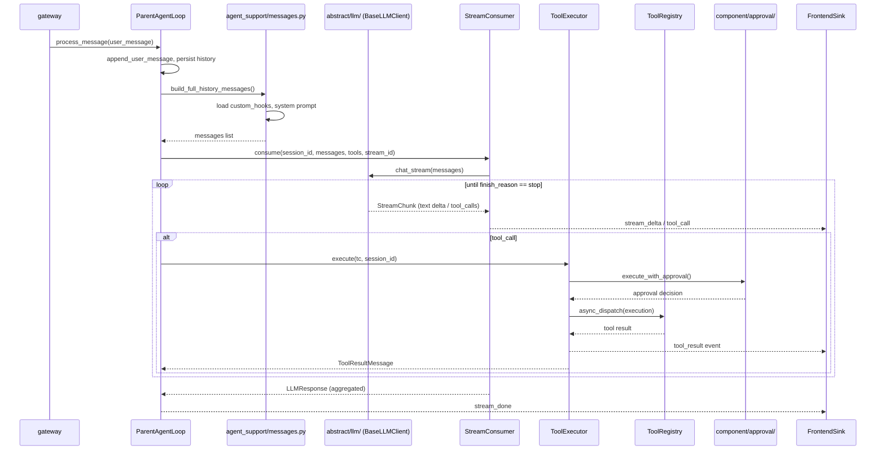

# entry/ — Agent 主循环

`entry/` 包含 Evolve Agent 的核心消息处理循环与相关抽象。它是用户消息进入系统后，经过 LLM、工具、审批、前端事件往返的主战场。

---

## 文件结构

```
entry/
├── base_agent_loop.py            ← BaseAgentLoop + BasePrivateChatAgentLoop + IMainSessionLoop
├── parent_agent_loop.py          ← 主 Agent 循环实现
├── colloquy_loop.py              ← ColloquyLoop（闲聊循环，继承 ParentAgentLoop）
├── multi_agent_loop.py           ← 多 Agent 广播协作循环
├── multi_agent_worker.py         ← 单 Agent tool loop 执行器
├── agent_sink.py                 ← FrontendSink / ParentAgentSink（契约见 interface/agent_sink.py）
├── history_projection.py       ← History 到前端骨架/内容页/资源索引的唯一投影层
├── session_message_queue.py      ← 主会话输入批次消费队列（普通输入保留合批与工具结果注入；强制调用工具输入独立成批）
├── session_manager.py            ← LoopSessionManager（session 生命周期）
├── stream_consumer.py            ← StreamConsumer（LLM 流式响应消费器）
├── tool_executor.py              ← ToolExecutor（统一工具调用执行器）
├── tool_execution.py             ← accept_tool_batch（工具批次接收声明）
├── tool_pairing.py               ← 共享中断配对辅助（不反向导入 Loop/ToolExecutor）
├── tool_post_dispatch.py         ← PreparedToolResult + ToolPostprocessor（提交后工具后处理）
└── agent_support/
    ├── messages.py               ← 消息组装：system prompt + hooks + history
    ├── history_summary.py        ← 会话历史摘要与文本转换
    ├── tool_chain_compress.py    ← 两个压缩工具共用的工具链检测与重打包纯函数层
    └── multimodal.py             ← 多模态处理与 content block 清洗
                                       NOTE: content_to_text 会自动过滤 JSON 中所有 _ 前缀字段（_image/_meta/_queued_messages/_note），
                                       避免 base64 或工具链嵌入消息载荷泄露到前端/日志。_meta 与 _queued_messages 等内部字段通过 emit_tool_result 的独立参数传递，分别由工具卡片元信息和嵌入消息区域渲染。
```

---

## 工具对象与四阶段执行（2026-10-15）

工具来源为 `BaseTool` 子类与顶层 `TOOLSET`，`ToolRegistry` 只持有对象；来源迁移与静态复核仍在收尾，完整任务复核与用户验收待完成，不能启动中间源码。`prepare_tool_result()` 为明确函数定义；`PreparedToolResult.execution` 关联本次工具调用，只有 `store_tool_result()` 成功提交后才写回 `history_index`/`result_message`。拒绝、中断结果不持有 execution，不进入专属 after，但仍按已有通知路径回显。

`ToolPostprocessor`（`tool_post_dispatch.py`）由主会话 ToolExecutor 和子会话 Loop 分别持有唯一实例。主体正常返回（含业务错误）且结果已提交后，通过 ToolRegistry 的 `async_postprocess(execution)` 请求托管执行 after；等待期间与取消信号竞速，超出短清理窗口仍保留真实任务强引用。`replacement_result` 同时更新正式消息和通知投影，并保留耗时、输入预订元信息；禁止更新已经离开 History 的结果。抑制工具结果事件时必须显式丢弃自身 ID，避免卡片永远等待。after 失败在工具循环内明确重新传播，不降级为普通工具错误。

ParentAgentLoop/MultiAgentWorker 在 assistant tool_calls 写入前通过 `accept_tool_batch()` 保留声明接受前缀，对后续项发送 `tool_calls_discarded`（携带 `session_id`/`stream_id`/`tool_call_ids`），中断补齐只针对接受前缀；已提交后被压缩移除的调用仍视为已执行，不能补回。工具上下文携带非持久化 `stream_id`。MultiAgentWorker 在下次请求前从共享 History 重建上下文。公共中断配对构造位于 `tool_pairing.py`，只依赖 `entity.messages`/`entity.puretype`，不反向导入 Loop/ToolExecutor。

EvolveCode 的关闭请求在专属 after 中唯一消费；`PreparedToolResult` 不再有 `evolution_requested`，ToolExecutor 提前消费和 `store_tool_result()` 关闭分支已移除。停止效果先配对本批未执行接受项，再追加完成文本并结束当前轮。普通子Agent仍内存提交、停止时保存，临时Agent仍不保存。`abstract/tools/ui_event_router.py`、`HandlerToolAdapter` 与函数注册发现均已从源码移除。

## 历史更新指令（2026-10-15）

两种压缩工具在实际结构替换并严格保存后同步调用 `ToolExecution.mark_history_updated()`，保存与标记之间没有 await。该调用级事实独立于 after 是否成功返回；`ToolPostprocessor` 成功路径在结果回填保存后发送 typed `history_updated`，再发送 `ToolPostprocessEffect.system_message` 和未抑制的工具结果。取消/后续失败时仍根据已提交标记尝试发送失效通知，然后传播原异常；通知失败与原错误以异常组保留，不发送压缩成功系统消息。完成系统通知不再在压缩 after 内等待，也不复用进化的 assistant `completion_message`。

压缩返回的 `discarded_tool_call_ids` 只用于内部移除事实/suppress 校验，Postprocessor不再发送 `tool_calls_discarded`；后者只由 `accept_tool_batch` 为从未被接受的批次后缀发送。suppress同时要求已提交结构更新标记及自身ID在移除集合中。`IAgentSink.emit_history_updated(session_id)` 不依赖 stream_id，FrontendSink沿既有TaskOwner/发送截止统一序列化 `HistoryUpdatedEvent`；ParentAgentSink不向父主会话投递子会话History更新。当前实际触发方仅为两种主会话压缩工具，普通追加、业务拒绝和零链结果回填不触发。源码已接入，尚未运行验证。

## 关键抽象

### `BaseAgentLoop` / `BasePrivateChatAgentLoop` / `IMainSessionLoop`

`base_agent_loop.py` 提供三层抽象：

- **`BaseAgentLoop`**：最基础的循环抽象，包含：
  - `Inbox` 带类型消息队列（`UserMessage`；SubAgentLoop 父→子通道使用，主会话已切 SessionMessageQueue）。
  - 取消控制（`interrupt()`、`is_interrupted()`）。
  - `ToolContext` 注入到工具 handler，替代旧的全局 `get_runtime_context()`；上下文携带必填 `round_id`，明确 `ws:` 文件接触通过 `agentspace_access()` fail-closed 登记。`request_evolution()` 仅登记本次调用的进化意图标记；结果提交 History 后由工具实例的 `after_handle()` 通过 `consume_evolution_request()` 唯一消费并在其中请求关闭，不再由所属 Loop 读取。
  - `ToolContext.resource_session_id`：长期资源归属的主会话 ID；主Agent/参与Agent使用当前主会话，子Agent/临时Agent使用公开 `parent_session_id`。
  - 回复轮次文件锁：`begin_agentspace_round()` / `current_agentspace_round()` / `end_agentspace_round()` 按角色管理唯一 round ID，并在完整回复收尾后幂等释放。
  - 通用持久化方法：`save_history()`、`load_history()`；压缩工具通过公开 `reset_context_tokens()` 将上一请求的 prompt token 计数置零，不直接访问 `_token_record`，累计 token 消耗保持不变。
  - 前端 History 只读投影：`get_session_history_skeleton(start_index)`、`get_session_history_page(start_index, limit)`、`get_session_history_resources()`；媒体能力探测使用无副作用的 `get_session_media_count()`，只统计当前 History 中的媒体实例，不补身份、不写盘。普通模式、多Agent模式与随意聊聊会话共享实现。子Agent虽继承该能力，但 Gateway 不为子会话暴露对应 REST。
  - 会话操作结果：`edit_session_message()`、`delete_session_messages()`、`delete_single_message()`、`regenerate_response()`、`get_tool_resources()`、`merge_sessions()` 均返回 `entity.puretype.session` 中的稳定 `BaseModel`；调用方通过属性访问；Gateway 普通 HTTP 返回值保留模型，由 FastAPI 自动序列化，显式 Response 则在发送边界编码。`LoopSessionManager._transfer_session_runtime_resources()` 同样返回 `SessionRuntimeResourceTransferResult`，不再通过字典键读取迁移状态。
  - Hooks 加载与上下文收集：`_load_message_hooks()`、`_collect_hooks_context()`。
  - 工具集加载状态：`_loaded_toolsets`（会话级已加载工具集名称集合）、`get_loaded_toolsets()`、`is_toolset_loaded()`、`load_toolsets()`、`_restore_loaded_toolsets()`、`_get_effective_tool_definitions()`（按已加载工具集 × scope 动态计算工具 schema）。
  - `get_tool_availability_scope()`：返回当前 Loop 的 `ToolAvailability`（默认 `EVERY`，子类覆写）。

- **`IMainSessionLoop`**：主会话专属接口，除历史/Profile/轮次能力外，还提供**强制中断**所需的公共实现：
  - `_init_round_registry()`：由主会话实现类在构造时调用，初始化 `_interrupt_lock`、`_active_round_task`。
  - `register_round_task(task)` / `unregister_round_task(task)`：登记/注销已经取得 `_process_lock` 的单次回复 task；长期队列 consumer 和等待锁的 child 不登记，重叠 task 被视为生命周期错误。
  - `has_active_round()`：以是否存在登记的单次回复 task 判定主会话是否忙碌，不以 `_processing` 为准。
  - `request_interrupt(reason, timeout)`：强制中断权威入口——设置当前轮次取消事件、终止本会话活动子进程、等待协作式收尾，超时后只强制取消该轮 task；返回 `MainSessionInterruptResult`（idle / cancelled / timeout / failed / not_found）。轮次 finally 在 task 完成前清除取消事件，后续消息不继承旧中断状态。

- **`BasePrivateChatAgentLoop`**：在基类之上增加 1-on-1 私聊循环模板，包含：
  - 历史管理（`History` 实例）。
  - LLM 调用抽象（`_get_llm_client()`、`_build_system_prompt()`）。
  - 会话级约定块注入：`ParentAgentLoop` 和 `MultiAgentLoop` 在 `_build_system_prompt()` 中注入 `build_session_site_block()`（会话网页 `site/`）和 `build_session_stage_block()`（Agent 舞台层 `stage/`）；`SubAgentLoop` 注入父会话的 site 和 stage block（`owner="parent"`）。
  - 工具执行与结果回环（`_execute_tool()`、`_get_tool_definitions()`）。
  - 上下文超限处理（`_on_context_over_limit()`）。

`ParentAgentLoop` 与 `SubAgentLoop` 均继承 `BasePrivateChatAgentLoop`。

- **`IMainSessionLoop`**：主会话 loop 接口（C#-style interface），不继承 `BaseAgentLoop` 以避免菱形继承。声明主会话特有的能力：`current_character_agent`、`set_profile()`、`pop_session_rotated()`、`get_token_usage()`、`get_context_tokens()`和强制中断生命周期。标题、标签、摘要不再属于 Loop 接口，统一由 `SessionMetadataService`承担。`ParentAgentLoop` 和 `MultiAgentLoop` 实现此接口。

### `ParentAgentLoop`

`parent_agent_loop.py` 中的 `ParentAgentLoop` 是面向用户的主循环实现，负责：

- 处理用户消息：`process_message()`。
- 流式 LLM 调用与实时前端推送（通过 `StreamConsumer`）。
- 工具审批：复用 `ToolExecutor` + `execute_with_approval`；safe 始终免审批，手动模式 write 也免审批；其余按模式分流到用户或审批模型，非 critical 可命中白名单，critical 在手动/脱手模式均由用户审批，YOLO 全部免审批。
- 会话旋转：当上下文接近上限时，通过 `LoopSessionManager` 在摘要保障成功后创建延续会话，最后才归档旧会话；摘要失败时保留当前会话与触发消息，追加系统状态并中断本轮。
- 标题、标签与摘要生成：统一委托 `Application.current().get_system(ISessionMetadataService)`；全局元数据 Profile优先，未配置时按目标会话活动 Profile回退。
- 子Agent编排：通过 `SubAgentOrchestrator` 启动/管理子 Agent。
- LLM Profile：活动配置始终是 `Application.current().get_system(ILLMProfileStore)` 根对象中的实例；`set_profile(None)` 表示明确无配置。主会话队列按sequence选取连续ready输入，普通消息可以合批，执行前使用批次最后一个非 `None` 的 `llm_profile_name` 选择；强制调用工具输入单独成批，避免被更晚消息覆盖请求归属。`resume()` 是从现有历史继续执行工具链的恢复操作，不追加用户消息、不截断历史，也不接收或更新 `llm_profile_name`；它使用当前 `ParentAgentLoop` 已持有的活动 Profile。需要切换 Profile 后重新生成时，应使用 `/regenerate`。

### `MultiAgentLoop` / `MultiAgentWorker`

`multi_agent_loop.py` + `multi_agent_worker.py` 实现多 Agent 广播协作模式：

- **`MultiAgentLoop`**：继承 `BaseAgentLoop` + 实现 `IMainSessionLoop`，管理共享 `History` 和多 Agent 并发调度。自身不直接调用 LLM，将每个 Agent 的执行委托给 `MultiAgentWorker`。
  - 持有 `dict[str, AgentProfile]` 配置档案；进入模式和会话恢复时由 `CharacterProfileResolver` 动态读取角色目录，运行中的 Loop 使用本次构造的快照。
  - 串行动态队列级联调度（`_cascade()`）：每步弹出一个 Agent，等待完全完成后启动下一个。
  - Agent 可通过 `response_characters` DSL 标签指定下一轮响应者。
  - 最大级联深度：`len(agents) * MULTI_AGENT_MAX_CASCADE_DEPTH`。
  - 聚合各 worker 的 token 统计（`_aggregate_worker_usage()`）。

- **`MultiAgentWorker`**：单个 Agent 的 tool loop 执行器，在独立上下文中执行完整的 LLM → tool_calls → 工具执行 → 循环。
  - 内部创建独立的 `StreamConsumer` 和 `ToolExecutor` 实例。
  - 每轮 LLM 调用使用独立 `stream_id`，确保前端固化为独立消息。
  - 输出自然语言 + DSL 路由标签（`@visible(...)` / `@response(...)`）。
  - 返回 `WorkerResult`（含 `AgentResponse` 解析结果）。

### `IAgentSink` / `IFrontendSink` / `FrontendSink` / `ParentAgentSink`

向上通信的抽象契约位于 `interface/`，`agent_sink.py` 只保留实现：

- **`IAgentSink`**（`interface/agent_sink.py`，ABC）：事件出口的唯一抽象类型，声明 `ask_question`（多问题表单，`questions: list[dict]` 参数）、`request_approval`、`emit_tool_call`、`emit_tool_result`、`emit_stream_delta`、`emit_stream_done`、`emit_usage_update`、`emit_progress`、`emit_clipboard_display`、`emit_subagent_update`、`emit_system_message` 等方法。
- **`IFrontendSink`**（`interface/frontend_sink.py`）：`AsyncSystem` System 槽位，同时继承 `IAgentSink`；只追加前端专有的连接、广播与交互解析契约，不重复声明事件方法。
- **`FrontendSink`**：主 Agent 使用，单一继承 `IFrontendSink`，依赖 `RuntimeSystem`。无参构造只创建内存字段；`virtual_awake` 取得 `RuntimeSystem` 并创建 `TaskOwner`。持有 `_ws_sinks`（session_id → WebSocket 映射）、`_pending_confirms` / `_pending_asks`（Future 映射），管理审批和提问的异步等待。提问为多问题表单：`ask_question(questions, session_id)` 下行 ask_request 携带 questions 数组，`resolve_ask(request_id, answers)` 接收按题回答列表（`AskAnswerItem`，None=整表跳过），Future 结果含 answers 与整表 answered_any。发送与交互属有调用方等待的请求级操作，经 `TaskOwner.run_request` 登记：新交互（审批/提问）只在 `RUNNING` 接收（`_admit_interaction` 经 `RuntimeSystem.require_running`）；既有结果与 History 回显在 `STOPPING` 仍允许到关闭输出（`_admit_send` 只检查 `_send_closed`），关闭发送期限不超过 `SHUTDOWN_SEND_TIMEOUT_SECONDS`（1 秒）。网络断线/明确发送超时只跳过网络输出，不回滚 History；模型构造/序列化错误与其他内部错误传播。`cancel_pending_interactions` 同步解除所有待审批/提问 Future；`close_all_connections` 以标准 1001 关闭所有连接，结束连接前等待/取消真实发送任务及交接，不把自身登记进同一 Owner 再等待。`close_session` 保留永久删除 4004 语义，与应用退出 1001 分开。流式事件单独构造 `StreamDeltaEvent` / `StreamDoneEvent`，只经 `_send_stream_event(StreamEvent)` 序列化发送；不再经过接收字符串的 `_send_msg()`。`virtual_shotdown` 关闭接收、取消在途请求并关闭连接，资源/内部错误传播。协议类型直接从 `entity.puretype` 导入，不依赖 `gateway.chat` 的兼容导出。
- **`ParentAgentSink`**：子 Agent 使用，实现 `IAgentSink`，通过 `SubAgentLoop` 的公开反馈记录接口与编排器通信；不作为 System。审批请求放入子 Agent 的 `_pending_approvals` 队列；事件转发通过 `Application.current().get_system(IFrontendSink)` 推送到父会话前端。

### 流式事件类型与传输边界

- `IAgentSink.emit_stream_delta()` 接收 `ToolCallRequest` / `ToolCallDelta` 实例，`StreamConsumer` 直接传递 `StreamChunk` 内的模型，不提前 `.model_dump()` 或手工拆成字典；`emit_stream_done()` 同样保留 `MessageMetrics` 实例。
- 两种纯数据模型定义在 `entity/puretype/ws.py`，以固定 `type` 构成 `StreamEvent` 判别联合；`session_id` / `stream_id` 必填且非空，拒绝额外字段，事件本身采用 frozen/strict 配置。工具动态参数仍是开放字典，参数片段仍是未闭合 JSON 文本，不逐片解析。
- `_send_stream_event()` 只在实际 WebSocket发送边界执行一次 `model_dump_json(exclude_none=True)`；模型构造/序列化错误与传输异常分开，后者记录脱敏定位信息，不额外按中断状态丢弃结束事件。`stream_delta.tool_call` / `tool_call_delta` 为顶层对象，前端不再解析 `content` 中的内嵌 JSON。
- `StreamDoneEvent.content=None` 在传输中省略，显式 `""` 与缺失具有不同意义。现有 `emit_stream_done(content="")` 调用仍按旧行为省略正文，保留前端累计的部分输出；`finish_reason` 保持开放字符串，兼容 Provider 结束原因及 `error` / `cancelled`。流结束前刷新前端增量缓冲，History 和实时行映射的顺序不变。
- `ParentAgentSink` 同步收紧参数类型，但子会话增量仍按模型属性适配到原有反馈通道，不引入新的子会话协议。
- 未使用的 `_tool_event_callback`、`set_tool_event_callback()`、启动注册及 Gateway `_send_tool_event()` 已移除。其他非流式消息继续使用原有协议与发送路径，本次不迁移其所有动态载荷。

### `LoopSessionManager`

`session_manager.py` 中的 `LoopSessionManager` 管理单个 `ParentAgentLoop` 实例的 session 生命周期（`ParentAgentLoop` 以 `self._lifecycle` 持有）：

- `initialize()`：从磁盘加载已有历史。
- `is_context_over_limit()`：判断 token 数是否接近配置上限。
- `rotate_session_for_continuation()`：先保障旧会话摘要，再初始化延续 History并归档旧会话；失败时完整恢复临时分离的用户消息。
- `terminate_session()`：摘要与标签均为 best-effort；失败以 `metadata_warnings`返回但仍归档，并在归档完成后停止该主会话全部 Shell。
- `pop_session_rotated()`：取出旋转通知（old_sid → new_sid）。

> `MultiAgentLoop` 不使用 `LoopSessionManager`，但复用 `terminate_and_rotate_session()`与同一个 `get_system(ISessionMetadataService)`完成多Agent自动旋转；元数据失败语义与普通模式一致。

### 流式消息与 History 行的权威关联

`ParentAgentLoop` 每次将流式 assistant 回复写入 History 后，在对应轮次的 `history_sync` 前通过现有 `system.stream_meta` 发送 `stream_id`、History 整数索引和工具行 `live_history_links`；用户消息复用 `USER_MESSAGE.index`，工具结果复用 `History.add_message()`返回索引。`MultiAgentWorker` 为共享 History 中的 assistant/tool_calls 和工具结果发送关联；`MultiAgentLoop._cascade()` 为最终 assistant 回复在既有可见性元数据中加入索引。`entry/stream_history_link.py` 统一构造关联事件，映射异常可诊断且不清空实时行；子Agent独立 History 不映射到主会话。前端只有在 skeleton 正典目标存在并完成交接后才清理实时行。

### `StreamConsumer`

`stream_consumer.py` 中的 `StreamConsumer` 封装 LLM 流式响应的增量消费：

- 接收独立依赖（`llm`、`sink`、`character_name`、`cancel_event`），不绑定任何 loop 类型。
- `consume(session_id, messages, tools, stream_id) -> LLMResponse`：消费完整流式响应，聚合 content/reasoning/tool_calls，推送增量到前端，返回结构化结果。
- **流式空闲超时**：使用独立 next 任务 + `asyncio.wait` 实现，连续 `LLM_STREAM_IDLE_TIMEOUT`（300 秒）未收到任何流式数据（content/reasoning/tool_call/usage）时自动停止本轮，产生明确的 idle-timeout 错误；任一有效数据到达即重置计时。超时与用户取消不共享 `CancelledError` 边界。
- **部分结果快照**：`partial_result(finish_reason="cancelled")` 只返回当前 stream 正常结束或强制取消前保存的本轮快照；每次 `consume()` 开始时重置，不会复用上一轮内容，也不伪造未完成的工具调用。
- **单一关闭者**：`consume()` 将共享取消事件与当前 `__anext__()` task 竞速；读取取消后由消费侧 finally 统一关闭异步迭代器。读取未在清理窗口内结束时延迟到读取真正结束再关闭，外部不并发调用 `aclose()`。
- 检测 LLM provider 是否返回了 token usage（若未返回则抛异常）。

> 由 `ParentAgentLoop` 持有；`MultiAgentWorker` 内部也创建独立实例使用。

### 主会话输入投递与关闭（S16进行中）

`InputDeliveryBuffer`是输入唯一登记表。`push/accept`在同步接收边界内先登记原始payload并返回sequence，再安排主loop唤醒；回调不重新登记，也不在关闭时丢掉已接受记录。消费者按sequence取得连续ready前缀，向Parent/Multi传递InputDelivery列表。每条消息复用所属Loop的角色、多模态与hook构造，同步追加后立即标APPENDED，严格保存成功才标PERSISTED，随后回显。已成功记录可释放但累计统计保留；保存失败由Loop持有HistoryPersistenceError并报告Runtime，不重试或重放APPENDED记录。

主会话回复用`reply_scope`在等待处理锁之前登记请求任务，覆盖普通消息、队列轮次与resume；应用关闭等待consumer、排队/活动回复和Loop交接，而用户中断仍只针对当前回复。SessionManager保留退出中Loop，替换时新队列接受输入但暂停消费，旧回复及工具结果提交结束后原sequence记录转交新队列；共享History在关闭时按全局sequence串行刷新。永久删除不借刷新重建会话。

工具结果使用`prepare_tool_result → store_tool_result → PreparedToolResult.emit`。ToolInputReservation只预订，不移除消息；绑定真实ToolResultMessage实例，提交实际消息后确认输入状态。普通子会话提交内存History，停止时由`SubAgentOrchestrator`等待任务收尾后刷新Inbox并严格保存；TaskAgent只完成内存交接，不新增持久化。准备失败或轮次中断释放未APPENDED预订，保存失败不可退回重放；通知/预订对象不写入easysave。

Gateway在创建后台任务前的多目标接收与ready准备已由 S21 完成，Application 激活/关闭编排已由 P22 接通；以上为源码实施与静态审阅结果，尚未运行验证。

### `ToolExecutor`

`tool_executor.py` 中的 `ToolExecutor` 是统一工具调用执行器：

- 封装单个工具调用的完整流程：取消检查、parse error 处理、审批（复用 `execute_with_approval`）、registry 分发、异常转换、前端事件推送，以及结果提交后交给 `ToolPostprocessor.after_committed()` 的专属后处理。
- `execute(tc, session_id, *, round_id, ...) -> ToolResultMessage`：执行单个工具调用；`round_id` 传入每个 `ToolContext`。
- `get_tool_stats()`：返回工具调用统计。
- 审批或 dispatch 等待与主会话取消事件竞速；handler task 取消只等待正式清理窗口，超时 task 由 `_cancel_cleanup_tasks` 强引用并在最终结束时观察异常，禁止无限阻塞主轮次。
- 工具 handler 的真实执行归 `get_system(IToolRegistry)`：异步请求由注册表的 TaskOwner.run_request 持有；异步 handler 内的同步历史扫描、磁盘读取或 CPU 密集计算必须改为同步 handler 并交给 ToolRegistry 的专用线程池，不能仅因声明为 async 就在事件循环线程执行阻塞逻辑。同步线程由注册表登记原生 Future。ToolExecutor 只持有本次审批/分发等待包装及中断清理；取消包装不表示底层线程已经退出。`cancel_tool_wait` 由主/子Agent共用，一秒窗口仅用于及时结束调用方等待，超出后保留包装 Future，真实取消期限由所属 System 的 TaskOwner 管理；不能在内层十秒清理期限尚未到达时误报失败。取消请求只发一次，迟到回调使用预先取得的 Runtime 引用；停止拒绝及预期取消不报告失败。停止、生命周期与 History 持久化失败（包括异常组）继续传播，取消收尾失败报告 Runtime；普通工具错误保持既有结果协议。
- 通过 `IMainSessionLoop.loop` 访问 loop 内部字段（`cancel_event`、`get_sink()`、`get_hooks_context()` 等）。

> 由 `ParentAgentLoop` 和 `MultiAgentWorker` 分别持有独立实例。

---

## 全局动态沙盒空间

- `ParentAgentLoop._build_system_prompt()` 每次构建上下文时从 Application 的唯一 Sandbox 取得 fast 模式动态空间块；`ColloquyLoop` 继承该提示词和空间使用能力。
- `MultiAgentLoop._run_single_agent()` 在每个参与Agent Worker 启动前刷新同一动态空间块。`sandbox` 管理工具在多Agent模式只向主Agent提供，非主参与Agent的有效工具定义会被过滤。
- 动态空间解析能力由 Sandbox 全局共享，不属于会话或 LLM Profile。临时Agent保持无系统提示词，但已知动态逻辑路径仍可通过 Sandbox 解析。

## Agentspace 回复轮次文件锁

- `ParentAgentLoop._run_tool_loop()` 为主Agent的一次完整 LLM→工具→最终回复创建 round ID，metrics 与事件收尾后释放。
- `MultiAgentLoop._run_single_agent()` 为每个参与Agent worker 独立创建 round ID，worker 结果和 token/metrics 聚合后释放。
- `ToolExecutor.execute()` 必须接收当前 round ID；任何明确 `ws:` 路径登记失败都会阻止对应工具执行。
- 锁只限制命中的工作空间路径，不把整个 Agentspace 设为只读；`custom_tools`、MCP 与绕过应用的外部进程属于不可预锁通道，由 watcher 和内容版本冲突处理。

---

## 消息处理流程



主要步骤：

1. `process_message()` 获取锁（主会话消息经 SessionMessageQueue 入队，由 `run_pending_round` 消费驱动轮次）。
2. `append_user_message()` 将用户消息追加到 `History` 并回显前端。
3. 检查上下文是否超限，超限则 `LoopSessionManager.rotate_session_for_continuation()`。
4. `_build_history_messages()` 组装 system prompt + hooks + 历史。
5. `StreamConsumer.consume()` 调用 `BaseLLMClient.chat_stream()` 流式生成。
6. 解析流中的文本 / tool_call，通过 `FrontendSink` 实时推送。
7. 对 tool_call 执行 `ToolExecutor.execute()`：按主会话策略检查审批模式、危险等级与白名单；手动模式 safe/write 直接执行，critical 在手动/脱手模式由用户审批，YOLO 全部免审批。该流程也适用于多Agent模式中的所有参与Agent，不使用独立子会话策略。
8. 工具结果加入历史，循环直到 `finish_reason=stop` 或达到 `MAX_TOOL_TURNS`。

> **延迟渲染与消费确认**：前端发送后先显示已排队徽章，空闲消费通过emit_user_message回显；工具链期间由ToolInputReservation把普通补充输入预订进结果的 `_queued_messages`，提交后通过 `embedded_messages` 和 `consumed_client_message_ids`展示并移除对应徽章。长期consumer为每批输入创建单次回复task，中断不销毁consumer。输入状态以InputDeliveryBuffer为唯一真相，预订不代表已追加或已保存，不重放已APPENDED输入。强制调用工具记录不进入工具结果，具体边界见本文件“单次强制调用工具与输入批次”一节。

---

### 主会话活动快照与首字前流式气泡

`BaseAgentLoop` 持有不写入 History 的主会话活动快照，覆盖队列排队、准备、等待首字、流式生成、等待审批和等待工具。`activity_id` 标识一次主会话活动；一次活动可包含多个 `stream_id`，每个 `stream_id` 对应一条前端实时流式气泡。用户消息、动态端点、子会话反馈和 Cron 通过 `SessionMessageQueue` 在实际入队时登记活动；恢复、重新生成和多Agent级联复用同一活动生命周期。

Gateway 的会话状态 REST 返回当前活动快照。前端在用户发送、恢复或重新生成时先创建乐观空 assistant 流式气泡，并在 WebSocket连接期间每秒轮询活动状态；连接恢复或页面重新可见时立即查询。首个 `stream_delta` 与轮询共用同一实时行收敛逻辑，换键到实际 `stream_id` 后继续复用已有气泡。WebSocket断开不等于 Loop空闲，重连后由活动快照恢复状态；空流在终态确定性清理。

## 会话旋转与上下文压缩

当单一会话的总 token 接近模型窗口上限时：

1. `LoopSessionManager.is_context_over_limit()` 检测超限。
2. `rotate_session_for_continuation()`先调用 `get_system(ISessionMetadataService).ensure_summary()`。开始生成摘要前，当前页面收到一条不写入 History 的系统状态：「上下文已达到上限，正在终结当前会话并创建延续会话。」摘要失败时不归档、不创建延续会话，保留触发消息并追加对 LLM 不可见的系统状态。
3. 摘要成功后创建新的延续会话，保留历史摘要与近期完整消息（`INHERIT_LAST_ROUNDS` 轮）；新会话创建后、旧会话归档前，由 `ApprovalModeStore.inherit_session()` 继承旧主会话当前的审批模式；完成 History 初始化后才归档旧会话。原会话 History 只追加一条终结说明，不替换原文。
4. `handoff_token_usage()`先把当前用量原样写回原会话，再为延续会话换上独立的空记录。禁止就地清零原记录，否则下一次写盘会把原会话的上下文用量写成 0。
5. 延续 History 载入当前 Loop 后，`SessionManager.rotate_session()`把 Loop 改挂到延续会话。随后把现有 WebSocket 改挂过去，发送 `session_rotated` 并立刻带上 `history_sync`。页面这时才路由到延续会话并读取历史。轮次结束时的再次同步只沿用已经切换的会话 ID，不再发送第二次旋转通知。
6. 迁移其余运行态资源（工具副作用、cron 任务）。手动延续和合并不走这条自动旋转路径。

上下文压缩模板仍位于 `compress.txt` / `compress_input.txt`，低层文本转换在 `agent_support/history_summary.py`；Profile选择、模型调用、失败分类与摘要持久化由 `system/session_metadata.py`统一管理。`CompressHistory` 工具在轮次级截断之外，还会对保留轮次内的完整工具链执行链压缩；独立 `CompressToolChains` 则仅扫描全部历史中的完整工具链，不截断轮次、不插入会话摘要。两者共用 `component/tools/_history_compression.py` 的替换准备入口，纯检测与构造仍位于 `agent_support/tool_chain_compress.py`，链摘要使用 `toolchain_summary.txt` / `toolchain_summary_input.txt` 及工具链摘要 Profile。未完成链和纯压缩占位链不参与；含新增真实调用的混合链仍可压缩。

`ParentAgentLoop._run_tool_loop()` 在本批工具结果提交后通过 `_get_full_history()` 重建下一请求上下文，压缩不需要修改循环内的旧请求列表。所有链摘要生成成功后才逆序替换、严格保存 History，再调用公开 `reset_context_tokens()`；保存失败传播，不保证共享内存自动回滚。此次保留原 `MAIN` 可用范围，不改多Agent或子会话请求路径。

---

## 会话变量提示词与继承

`build_session_variables_block`只注入目录/文件/meta/工具协议，不扫描或自动注入变量值。ParentAgentLoop（含Colloquy继承）每次构建时使用当前session_id，MultiAgentLoop在每个参与Agent启动前动态追加，不写入角色Profile；普通子Agent使用父会话ID，临时Agent继续空系统提示词。

自动旋转公共函数`terminate_and_rotate_session`及BaseAgentLoop.merge_sessions在保障摘要后捕获完整变量材料，再同步创建新会话、独占安装variables和初始化History，提交前复查来源/目标存在且非删除中；成功退出安装scope后才归档来源。单来源保留路径、多来源放sources/<父ID>/。来源文件原bytes保留，包括无效JSON/meta及其他普通文件，不自动修正。

已知无法完整继承时，自动旋转经MetadataGenerationError与既有report_context_limit_rotation_blocked报告修复路径并保留旧会话/触发消息，本轮停止、不自动重试；分支/合并返回merged=false。初始化发生取消、History写失败或意外错误时必要回收新索引/审批缓存和本次变量目标，并传播原异常；必要清理失败以LifecycleFailure/异常组保留。提交后的归档/资源迁移失败不回滚已提交的新会话。索引已有持久化策略并非跨文件事务。

读改写非原子，主Agent统一共享结算；旧子Agent在旋转后保留旧parent_session_id，晚到写入不自动同步。重新生成/删除History消息不回滚变量，永久删除会话保留工作空间变量文件，与stage清理规则一致。

## 会话离线导出：History 捕获基础

`BaseAgentLoop` 持有非持久化 `_session_export_instance_id` 与 `_session_export_epoch`。保存成功、新活动、会话 ID 变更，以及普通模式的历史加载/重置更新代际；多Agent旋转复用公开 `set_session_id`。公开 `get_session_export_guard()` 与异步 `capture_session_export_source()` 只读取当前已恢复且空闲的 History，不补媒体身份、不写盘、不调用模型，不等待整轮回复锁。

`entry/session_export.py` 通过显式迭代栈按节点/时间软预算让出主事件循环，隔离消息正文、角色列表和工具请求可变结构；不可变大媒体字符串保留引用。消息后 `SessionExportHistorySource` 供线程侧 `export_history_digest` / `project_export_history` 计算摘要和既有完整投影，未知模型/超预算明确拒绝，错误通过业务边界处理。不同工具请求 ID 的唯一性由服务端保证，导出不另建重复 ID 策略，不改变在线配对口径。该节描述已实施基础；完整服务/前端接入与运行验收状态见任务文件，未运行校验。


## `agent_support/` 子模块

### `messages.py`

- `build_full_history_messages()`：组装 system prompt + hooks 上下文 + 历史消息。
- `collect_all_hooks_context()`：收集所有 custom_hooks 的上下文块。
- `load_message_hooks()`：加载 hooks 定义。hook 以 `spec_from_file_location` 动态加载，能否成功取决于加载时 `sys.path` 是否已含 agent 根目录；失败以 ERROR 级别记录文件路径，结果按 loop 实例缓存到进程结束。
- `_call_hook_with_runtime_ctx()`：优先以 `session_id` / `workspace` / `runtime_ctx` 关键字调用；只有参数绑定失败（TypeError 无更深帧）才回退两参数调用，hook 内部自抛的 TypeError 直接上抛，避免重复执行并重复推进缓存/计时状态。
- 单轮收集失败以 WARNING 级别记录对应 `tag`；`workspace` 参数是 `RuntimeContext.workspace`（`workspace/` 根目录），不是 agentspace。
- `build_agent_system_prompt()`：为子 Agent / 多 Agent 构建系统提示词。

### `history_summary.py`

- `summarize_history(history, llm) -> str`：用 LLM 对完整历史做压缩生成摘要。
- `messages_to_text(messages) -> str`：把 `BaseMessage` 列表转换为适合 LLM 阅读的纯文本。
- `extract_last_rounds(history, rounds) -> list[BaseMessage]`：提取最后 N 轮消息的原始对象。

### `tool_chain_compress.py`

- `detect_compressible_chains(messages, min_chars) -> list[ToolChainSpan]`：检测可压缩工具链（链内 tool_call 全部已配对结果、含真实调用、原始体积达 `TOOL_CHAIN_COMPRESS_MIN_CHARS`）；进行中的本轮链因缺少结果天然排除，纯压缩占位链跳过。
- `chain_to_summary_input(chain_messages) -> str`：链文本化（复用 `messages_to_text`，不设全局截断）。
- `build_compressed_chain_messages(chain_messages, summary) -> list[BaseMessage]`：把整链重打包为「伪造的 `CompressedToolChain` 调用（不可调用，参数携带调用数与工具名清单）+ 携带链摘要的配对 ToolResultMessage」。
- 纯函数层，不访问运行时服务；链摘要由 `CompressHistory` / `CompressToolChains` 通过 `component/tools/_history_compression.py::prepare_tool_chain_replacements()` 共用 `SessionMetadataService.generate_tool_chain_summary()` 预生成，返回 `entity.puretype_after` 显式导出的 `ToolChainReplacement`，全部成功后调用方才通过 `History.replace_range()` 应用替换。`ToolChainSpan` 仅含索引，继续定义于消息前纯类型 `entity/puretype/session.py`；`ToolChainReplacement` 持有正式消息实例，定义于消息后纯类型 `entity/puretype_after/session.py` 并直接导入 `BaseMessage`，不再由业务模块补装配。两者因类型依赖不同分属两个时期，检测与重打包职责保持不变。

### `history_media.py` 媒体能力投影

`count_history_media(history)` 是无副作用的媒体实例计数入口，复用 `iter_history_media()`，与完整媒体 REST 的 `total_count` 同源但不调用身份补齐或写盘。`BaseAgentLoop.get_session_media_count()` 通过公开方法供 Gateway 的会话 Tab 能力探测调用；完整媒体清单仍由 `get_session_media()` 负责身份迁移和分页投影。

### `history_projection.py`

- `history_row_id()`：按 History 索引和工具调用子索引生成一个骨架代际内稳定的前端行 ID；工具行是以 `tool_call_id` 聚合请求与结果的工具调用卡片。
- `project_history_skeleton()`：扫描完整 History 建立请求—结果配对，生成不含正文和富媒体的全历史骨架或后缀；匹配的 ToolResultMessage 不再产生独立视觉行。
- `project_history_content_rows()`：按完整 History 的请求/结果范围返回普通消息、工具调用卡片和孤立结果降级行，支持结果跨 History 内容页配对。
- `project_history_resources()`：从完整 History 提取去重后的图片和下载资源索引。

投影是只读视图，不改变 `History` 类型、消息实例或 easysave 存储。工具结果 `_meta` 与 `_queued_messages` 分别通过 `agent_support.multimodal.extract_tool_call_meta()` / `extract_tool_embedded_messages()` 与旧序列化路径共用口径。

### 多模态能力生命周期（S14）

预处理消息的探测/转发与系统提示词的缓存读取通过ModalityCapabilitySystem实例。完整请求由System的TaskOwner持有，六路子探针使用TaskGroup收尾；主/参与Agent的模型错误转换边界明确透传停止、取消及生命周期异常组，不把关闭清理失败变成普通LLM错误回复。`ParentAgentLoop._run_tool_loop` 与 `MultiAgentWorker` 的多模态预检调用同样纳入模型错误转换边界：无法转发（`ModalityForwardUnavailableError`，无引用Profile）时终止本轮并把配置指引作为持久化系统状态展示给前端；探针/转发途中的provider错误降级为用户可见错误，不再穿透炸轮次。纯内容块构造、文本转换与显式Profile引用解析仍为独立函数。

### `multimodal.py`

- `wrap_forwarded_description()`：用特殊标签包裹转发描述文本。
- `tool_result_to_content()`：将工具结果转换为 LLM content blocks。
- `content_to_text()`：将 content blocks 提取为纯文本摘要（用于日志或前端展示）。
- `extract_tool_call_meta()`：从原生 dict 工具结果只读提取 `_meta` 副本，供旧消息序列化与 History 内容页投影共用。
- `extract_tool_embedded_messages()`：从 `_queued_messages` 提取工具执行期间排队到的用户消息；同时兼容旧版 `queued_messages`，供实时事件和 History 投影的独立嵌入消息区域使用。
- `summarize_message_for_log()`：独立的日志安全视图，支持内存态/序列化态块及单个 dict 块；图片、音频、视频替换为占位符，未知块不输出载荷。默认预览上限为 300 字符；原本不限长的日志入口可传 `max_text_len=None`。不修改 `content_to_text()` 的前端展示行为。

---

## 主会话媒体输入与每请求准备

`history_media.py`提供媒体实例遍历、缺身份归一化、稳定ID定位、轻量分页、候选History及按需预览解析，无Application查询或I/O。控制对象仅为list正文的ImageBlock/AudioBlock/VideoBlock，不扫描Markdown或原工具dict中的文本载荷，不按文件内容去重。

BaseAgentLoop公开 `ensure_media_identity`、`get_session_media`、`get_session_media_block`、`set_session_media_enabled`、`commit_media_description`。身份补齐先保存；开关/成功描述用 `_persist_history_value` 保存候选后更新权威原块，不替换live消息引用，不在处理锁外等整次回复，不在线程池改live History。失败沿已有HistoryPersistenceError上报。正文编辑只有同位置同载荷媒体沿用原实例，否则新实例默认开启。

`multimodal.py::PreparedMultimodalRequest.capture` 在首个await前浅复制消息/块，固定send_multimodal和可信缓存；`prepare_main_multimodal_request`对开启块按tool/user能力直传或转发，对关闭块优先可信描述、可用单跳转发、明确不可用占位，其他错误继续失败。全关闭不做主模型探针。源视图一直保留原媒体，不能把准备后的文字视图赋回循环messages/full_messages。

ParentAgentLoop将最后用户消息按对象身份重连到请求副本，保留动态后缀；MultiAgentWorker仍传None，保持现有后缀语义。描述迟到提交先验证sid/History/实例仍有效，使用最新开关，仅更新成功缓存；不能重建被删除的实例。旧未证明成功的描述不作为可信缓存，已验证描述按实例first-success-wins。

不含子Agent或临时Agent独立历史，不改变原工具结果配对、History整体存储、压缩与旋转策略。原始媒体和前端展示保持，媒体输入Tab的开关从保存后的下一模型请求生效。源码已实施，人工验收/构建尚未运行。

---

## 与子代理的关系

`ParentAgentLoop` 通过 `main.py` 中挂载的 `SubAgentOrchestrator` 创建子 Agent。子 Agent 本身也是 `BasePrivateChatAgentLoop` 的实现（`SubAgentLoop`），但通过 `ParentAgentSink` 将事件路由回父会话的前端。详见 `../subagent/DEV-README.md`。

## System 接口槽位约定（2026-10-20）

`FrontendSink` 单一继承 `IFrontendSink`；`IFrontendSink` 是 Application 的 System 注册槽位和跨模块查询类型，并继承接口层的 `IAgentSink` 获得全部事件出口契约。`ParentAgentSink` 不是 System，直接实现 `IAgentSink`。entry 目录内所有对前端出口的 Application 查询均使用 `IFrontendSink`，不再以 `FrontendSink` 作为槽位类型。

## 事件契约分层（2026-10-21）

向上通信的事件契约只在 `interface/agent_sink.py::IAgentSink` 声明一次：

- `IAgentSink(ABC)`：15 个事件与交互方法（`ask_question`、`request_approval`、`emit_*`），是主会话与子 Agent 出口的唯一抽象类型。
- `IFrontendSink(AsyncSystem, IAgentSink)`：只追加前端专有的连接与广播契约（`register_ws`、`close_session`、`broadcast_*_profile_change`、`resolve_*` 等），不重复声明事件方法。
- `FrontendSink(IFrontendSink)` 与 `ParentAgentSink(IAgentSink)` 分别实现各自契约；`entry/agent_sink.py` 不再定义 `AgentSink`。

因为 `IFrontendSink` 是 `IAgentSink` 的子类型，从 System 槽位取出的 sink 可以直接传给任何声明 `IAgentSink` 的 Loop、StreamConsumer 或审批执行器，不需要 `cast`。新增事件方法只改 `IAgentSink` 一处，两个实现和所有调用方同时生效。

WebSocket 关闭观察超时保留原连接引用并记录资源清理待完成。`StreamConsumer` 接收 Runtime 持有的清理登记器，用于跟踪既有延迟关闭任务；Provider 自身的非超时关闭错误仍按原日志策略处理。

## 单次强制调用工具与输入批次（2026-10-23）

ParentAgentLoop.process_message/_run_tool_loop与MultiAgentLoop.process_message/_cascade显式接收默认false的 `require_tool_call`。Parent与MultiAgentWorker.run以局部first_request_pending在首次consume之前取值并清除，不依赖可被工具重置的计数器；后续工具请求自主选择。多Agent级联在有效初始响应者过滤后建立局部集合，每角色首次实际启动前移除，动态提前仍保留一次，后续回调/新加入角色不强制。resume沿默认false路径，不从历史重建选择。随意聊聊通过继承生效，辅助模型/子会话默认false。

QueuedMessage持有非持久StrictBool字段。普通消息仍可合批和进入工具结果；只有已固定为true的输入通过 `reserve_pending(isolate=...)` 单条成批，Parent/Multi在消费前断言该批次只有一条。ToolInputReservation使用 `stop_before`：对ACCEPTED或RESERVED记录在状态跳过、ready检查前识别强制屏障，禁止越过等锁的强制消息吸收更晚输入；已APPENDED记录不阻挡，普通RESERVED仍可跳过。忙碌补充发送固定false，不因此改为独立轮次。

InputDeliveryBuffer在同一锁内先完成所有候选选择/同步无副作用谓词判断，再统一修改state与reservation_id；谓词异常不留下部分预订。新可选参数默认None，其他Inbox及关闭预订行为不变。控制字段不进入 `_queued_messages`、CharacterConversationMessage或History持久化，输入移交直接保留payload。只做源码及文档实施，未运行校验、构建或应用。

