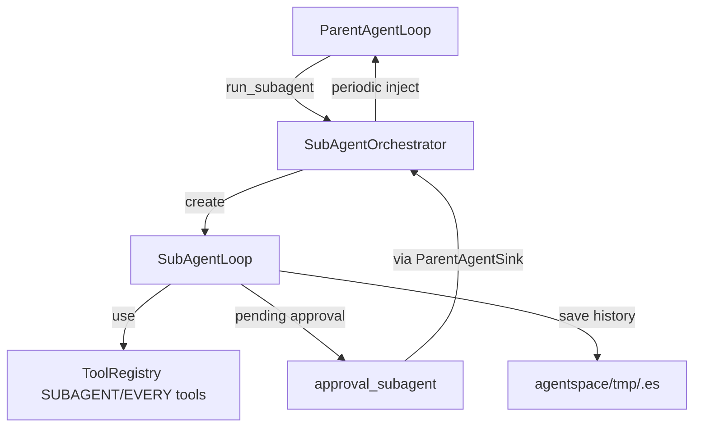

# subagent/ — 子代理与多代理系统

`subagent/` 与 `component/multiagenttools/` 共同实现 Evolve Agent 的多代理运行时。它包含两套系统：主 Agent → 子 Agent 的编排模式，以及多 Agent 广播协作模式。

---

## 文件结构

```
subagent/
├── orchestrator.py          ← SubAgentOrchestrator + _OrchestratorContext
├── loop.py                  ← SubAgentLoop（子代理循环实现）
├── taskloop.py              ← TaskAgentLoop（一次性临时Agent循环）
└── context.py               ← SubRuntimeContext（子代理/临时Agent运行时上下文构建）

component/multiagenttools/   ← 多代理 / 子Agent工具
├── profile_builder.py       ← 动态角色档案到多Agent Profile的构造
├── list_subagents.py        ← ListSubAgents
├── run_subagent.py          ← RunSubAgent
├── stop_subagent.py         ← StopSubAgent
├── run_taskagent.py         ← RunTaskAgent
├── stop_taskagent.py        ← StopTaskAgent
├── chat_subagent.py         ← ChatSubAgent
├── approval_subagent.py     ← ApprovalSubAgent
└── ...                      ← 其他多Agent工具
```

---

## 工具对象与四阶段执行（2026-10-15）

普通子Agent和临时Agent已接入对象工具 execution 与共享 `ToolPostprocessor`，不调用主会话 `ToolExecutor.execute()`，父Agent审批、脱手模式与临时Agent的 TASKAGENT∩safe 授权保持不变。每批模型调用先按工具声明截断，再写 assistant History；被声明丢弃的调用不审批、不执行、不补结果。

`store_tool_result()` 仅写内存 History并绑定真实结果/index，之后执行 after。主体异常转换的错误结果不运行 after；主体正常返回的业务错误仍运行 after。after 异常在工具批次与外层 run 的普通异常边界均继续传播。取消/停止只配对已接受且尚未执行的调用；阶段完成文本进入本子会话History和反馈，不写入父会话主聊天卡片。

普通子Agent依旧在停止时严格保存最终 History；TaskAgent整个流程不新增 History持久化。工具来源已统一为 `BaseTool` 子类与顶层 `TOOLSET`，共享 `ToolPostprocessor` 取代旧函数工具适配器与事件路由；来源迁移与静态复核仍在收尾，完整任务复核与用户验收待完成，本阶段未运行测试、校验、导入或应用。

## 两套多代理系统

`ParentAgentSink.emit_history_updated()`不向父主会话发送子会话History更新；当前两种压缩工具仍为MAIN范围，不开放给普通子Agent或临时Agent。新增指令不会改变父Agent审批、safe-only授权、内存提交与停止保存边界。

### 1. 子代理模式（SubAgent）

主 Agent → 子 Agent 的编排模式：



核心设计：

- **按父会话隔离**：`SubAgentOrchestrator` 为每个 `parent_session_id` 维护一个 `_OrchestratorContext`。
- **一条子代理 = 一个 `SubAgentLoop` 任务**：启动时创建独立 `asyncio.Task`，在 `loop.run()` 内完成 LLM 调用 → 工具执行 → 结果回写。
- **工具权限隔离**：子代理只能看到 `availability` 包含 `SUBAGENT` 或 `EVERY` 的工具；递归创建子代理的 `multiagent` 工具集仅对主代理可见（`MAIN`）。
- **审批流**：使用父主会话的审批模式。safe、白名单命中或 YOLO 直接执行；手动模式其余调用等待父Agent通过 `ApprovalSubAgent` 审批（不是用户弹窗），脱手模式则由审批模型处理。多Agent模式参与者使用主会话策略，与此独立子会话路径不同。
- **启动事务与失败可见性**：普通子Agent和临时Agent启动时先登记启动状态，再完成上下文、历史和前端回放事件准备；不设置活跃数量上限，也不进入等待队列。显式传入的 `.es` 历史加载失败会使启动失败，不会降级为空历史；启动阶段异常统一回滚 `_active`、任务和 waiter。
- **结果收集**：事件驱动——子代理通过 `append_feedback()` 登记 `SubAgentFeedbackDelivery`，或改变待审批队列时唤醒 waiter。正常运行的 waiter 将未交接反馈一次性投递到父会话；关闭阶段先冻结 waiter，反馈由专用关闭交接转入父会话关闭批次，不能重新启动父模型。
- **稳定类型边界**：`launch()`、`chat()`、`approve()`、`stop()` 与 `get_snapshot()` 在 `SubAgentOrchestrator` 和 `_OrchestratorContext` 之间只传递 `entity.puretype.subagent` 中的 BaseModel；工具结果和 WebSocket/HTTP 序列化仅在边界处执行。`SubAgentSnapshot` 统一定义 `status`、`feedback`、`pending_approvals` 与 `interactive`，调用方通过属性访问，不再依赖字典键。
- **响应与状态**：编排响应不持久化，不保留旧排队协议：启动结果仅含 `success`、可选 `session_id` / `error`；停止结果仅含 `success`、`session_id`、可选 `session_path` / `error`。删除 `SubAgentPromotion`，状态仅为 `running` / `completed` / `terminated`；History 持久化结构保持不变。
- **历史持久化**：停止时先请求并等待子Agent任务及工具收尾，再把未消费 Inbox 追加到 History，最后通过 `save_history()` 写入 `agentspace/tmp/<session_id>.es`；使用 `easysave` 多态序列化。TaskAgent只完成内存交接，不保存历史；角色是否长期保留历史由 Agent 自行移动。

### 2. 多 Agent 协作模式（MultiAgent）

通过 `enter_multi_agent` 工具切换。切换后所有用户消息由 `MultiAgentLoop` 处理：

- 所有参与 Agent 共享同一份对话历史（`History`）。
- 每条用户消息触发一轮串行级联响应。
- Agent 可在回复中通过 `response_characters` DSL 标签指定下一轮的响应者。
- `MultiAgentWorker` 是单个 Agent 的一轮响应执行器，由 `MultiAgentLoop` 创建并聚合 token 统计。
- 多 Agent 模式下 multiagent 工具集被禁用。

详见 `../entry/DEV-README.md` 中的 `MultiAgentLoop` / `MultiAgentWorker` 章节。

---

## 关键类

### `SubAgentOrchestrator`

`subagent/orchestrator.py` 的顶层编排器，职责包括：

- 按父会话维护 `_OrchestratorContext`（活跃子代理、启动状态、后台事件 waiter）。
- 创建/停止/查询子代理。
- 将子代理事件路由到父会话的 `FrontendSink`。
- 批量收集子代理输出并注入父 Agent 的消息循环。
- `launch()`、`chat()`、`approve()`、`stop()`、`get_snapshot()` 分别返回 `SubAgentLaunchResult`、`SubAgentChatResult`、`SubAgentApprovalResult`、`SubAgentStopResult`、`SubAgentSnapshotResponse`；调用方通过属性读取。
- 生命周期由 `Application.shutdown()` 管理（`shutdown_all()`）。

`SubAgentOrchestrator` 是 framework `AsyncSystem`，依赖 `RuntimeSystem`、`SessionManager` 及子Agent运行所需的已注册业务 System。`virtual_awake` 只取得依赖，不创建启动用 Loop；每个上下文在运行时通过 `SessionManager` 查询真实父会话。启动、运行、waiter 和状态推送任务均由上下文的强引用表持有，关闭时按冻结输入、等待任务、刷新 History、交接反馈顺序收尾。


单个父会话的运行时上下文：

- `_active`：当前活跃的子代理映射（`session_id → SubAgentLoop`）。
- `_active_task`：活跃子代理的 asyncio.Task 映射。
- `_starting` / `_startup_tasks`：启动阶段的实例登记和可取消初始化任务，用于重复启动防护与失败回滚；不承担数量限制。
- 事件驱动 waiter：子 Agent 完成后自动收集并推送结果。

### `SubAgentLoop`

`subagent/loop.py` 中的子代理核心循环，继承 `BasePrivateChatAgentLoop`：

- 处理由 `InputDeliveryBuffer[InboxMessage]` 驱动的 Inbox、反馈记录、工具审批、事件推送。
- 初始 prompt 与父Agent消息都先登记 sequence，再追加到内存 History；关闭时未消费记录按原角色和文本格式补入 History。
- 使用 `SubRuntimeContext` 拥有独立的 LLM 配置。
- 工具调用挂起时进入 `_pending_approvals`。
- 通过 `ParentAgentSink` 与父 Agent 通信。

### `SubRuntimeContext`

`subagent/context.py` 构建子Agent与临时Agent运行时上下文。普通子Agent从动态 `CharacterProfile` 的 `profile.md` 和 `[llm_profile]` 引用构建；临时Agent则保存发起 `RunTaskAgent` 调用时父主会话活动 LLM Profile 的非持久化深快照，并据此创建客户端。

### `TaskAgentLoop`

`subagent/taskloop.py` 实现一次性临时Agent：只接收单个 prompt，无系统提示词、无历史持久化，产生纯文本结果或达到工具循环上限后终止。临时Agent不受数量上限限制，也不进入等待队列。

临时Agent的工具定义与执行期授权都使用同一交集：当前实例已加载工具集中的工具，且 `availability` 包含 `TASKAGENT`，同时 `danger_level` 为 `safe`。因此临时Agent不会进入父Agent或审批模型流程；陈旧或伪造的越权工具调用直接返回失败工具结果。`LoadToolset` 本身符合该交集时可以调用，但加载只改变已加载集合，不会授权非 `TASKAGENT` 或非 `safe` 工具。当前新实例默认从 `core` 开始；后续可按任务类型预加载工具集以减少工具循环轮次，但不得绕过权限交集。

### 动态角色档案

`subagent/profile.py::CharacterProfileResolver` 每次从 `agentspace/characters/roleplay/` 和 `agentspace/characters/task/` 扫描角色目录：

- 每个角色目录必须包含 `profile.md` 和同级 `profile.md.meta`。
- `profile.md.meta` 的 `[description]` 是可选的简短简介；允许多行，解析后只去除首尾空白，保留内部换行且不截断。它只用于角色发现目录和主Agent系统提示词，不替代 `profile.md` 的系统提示词。
- `profile.md.meta` 的 `[llm_profile]` 引用运行时 LLM Profile；`[profile]` 可按行声明附加系统提示词逻辑路径。
- `profile.md` 作为第一个自定义系统提示词；元数据中的 `[profile]` 可按行声明额外的沙盒命名空间路径，系统按声明顺序加载每个文件并分别作为独立 system message。
- 元数据中的 `[llm_profile]` 直接引用 `llm_profiles.es` 中已有的 Profile 名称。
- `profile.md.meta` 的 `[avatar]` 是可选的角色头像逻辑路径键（值取首行非空内容）；仅服务前端展示（`system/character_avatars.py` 轻量扫描 + `/files` 服务），不属于可运行性校验——`[avatar]` 声明无效不影响角色启动，头像扫描也不依赖 `discover()` 的重量级加载。
- `[profile]` 中的路径不存在、不是文件或不具备当前沙盒的读取权限时，列表保留条目并返回错误，启动入口拒绝该角色。
- 角色名称跨 `roleplay` 与 `task` 全局唯一；重复名称保留为错误条目但不可启动。
- 缺失档案、元数据格式错误、缺少引用或 Profile 不存在时，列表保留条目并返回错误；启动入口拒绝该角色。
- 解析不使用持久化注册表或内存缓存；Profile 配置不复制到角色目录。

### 历史与临时Agent

普通子Agent停止时默认保存到 `ws:tmp/<session_id>.es`。只有 `RunSubAgent` 显式传入 `.es` 的 `history_path` 才会加载历史；Agent 可以自行将临时历史移动到角色目录或其他 `ws:` 路径。显式历史加载发生在启动提交前，文件不存在、类型不匹配、版本不兼容或历史清洗失败都会拒绝启动；启动状态异常时回滚已登记状态。

`TaskAgent` 使用调用时活动 LLM Profile 的非持久化快照，不经过角色档案解析、等待队列，也不保存历史。临时Agent正常完成后释放自身运行资源。

### `profile_builder`

`component/multiagenttools/profile_builder.py` 提供多 Agent 模式的 Profile 构造逻辑：

- `build_multi_agent_tools(tool_registry)`：返回多 Agent 模式下可用的工具定义（MAIN 工具集排除 multiagent 工具集）。
- `build_agent_profile()`：为多 Agent 模式中的单个 Agent 构造 `AgentProfile`（系统提示词、工具列表、LLM 客户端）。
- 通过 `llm_client_factory` 回调保留不同调用方对 LLM 客户端获取方式的差异。

### 子代理系统提示词注入

`ParentAgentLoop._build_system_prompt()` 在主Agent scope 下每次动态扫描并注入当前可运行子Agent的名称、类型和简介；无效角色不进入该目录，但仍由 `ListSubAgents` 返回错误详情。

`SubAgentLoop._build_system_prompt()` 在 `SubRuntimeContext.system_prompts` 基础上动态注入父会话级约定块（`owner="parent"`）。普通角色的系统提示词由 `profile.md` 与 `profile.md.meta` 的 `[profile]` 路径按顺序组成，每个文件保持为独立 system message：

- `build_session_site_block(parent_session_id, owner="parent")`：父会话网页 `site/` 约定。
- `build_session_stage_block(parent_session_id, owner="parent")`：父会话 Agent 舞台层 `stage/` 约定。
- `build_toolset_catalog_block()`：已加载工具集目录。

这些约定块告知子 Agent 网站部署区和舞台层属于父会话而非自身，写入路径为 `ws:sessions/<parent_session_id>/site/` 和 `ws:sessions/<parent_session_id>/stage/`。

此外，`SubAgentLoop._build_system_prompt()` 每次调用都会注入 fast 模式全局动态沙盒空间块。动态映射由 Application 的唯一 Sandbox 持有，与父会话、子会话和 LLM Profile 无关，所有子Agent共享；子Agent不能加载仅 MAIN|MULTI_AGENT 可见的管理工具。`TaskAgentLoop` 继续保持无系统提示词，但若任务中已给出动态逻辑路径，文件工具仍通过共享 Sandbox 解析。

---

## 子代理工具

| 工具 | 能力 |
|---|---|
| `ListSubAgents` | 动态扫描所有角色档案，返回名称、类型、简介、档案路径、Profile名称、错误和运行状态。 |
| `RunSubAgent` | 按当前动态角色档案启动子Agent，可显式传入 `.es` 历史。 |
| `ChatSubAgent` | 向活跃子Agent发消息。 |
| `ApprovalSubAgent` | 批量审批/拒绝子Agent的工具调用。 |
| `StopSubAgent` | 停止子Agent并将历史保存到 `ws:tmp/<session_id>.es`。 |
| `EnterMultiAgent` | 将当前主会话切换到多Agent协作模式。 |
| `ExitMultiAgent` | 退出多Agent协作模式。 |
| `AgentsGroup` | **当前未实现**，调用会抛出 `NotImplementedError`。 |

---

工具结果使用 `prepare_tool_result → store_tool_result → PreparedToolResult.emit`；普通子Agent先提交内存 History，停止时再严格保存，TaskAgent只提交内存并永久不保存。

子代理的工具集不是"除了 multiagent 之外的所有工具"，而是由 `ToolRegistry.get_definitions_for_loaded_toolsets(ToolAvailability.SUBAGENT, loaded_toolsets)` 决定。每个工具注册时可声明 `availability` 位掩码：

- `MAIN`：仅主 Agent 可见。
- `SUBAGENT`：子 Agent 可见。
- `EVERY`：两者都可见。

例如，创建子代理的 `run_subagent` 等工具标记为 `MAIN`，避免无限递归。

子代理拥有独立的会话级工具集加载状态（`_loaded_toolsets`），默认从 `core` 开始。`SubAgentLoop` 和 `TaskAgentLoop` 通过 `get_tool_availability_scope()` 返回各自的 scope（`SUBAGENT` / `TASKAGENT`），工具定义按已加载工具集动态计算。`TaskAgentLoop` 还在定义侧与执行侧同时施加 `danger_level == safe` 过滤，因此其权威范围是“已加载工具集 ∩ TASKAGENT ∩ safe”，不会产生审批请求。

多 Agent 模式下，`MultiAgentLoop._run_single_agent()` 使用 `self._get_effective_tool_definitions()` 动态获取工具定义，参与Agent共享主会话的加载状态。

### 工具口径三处统一（LLM 表 / 执行期 / ShowTool）

- **LLM 工具表**：`SubAgentLoop.run()` 的 LLM 调用点使用 `_get_tool_definitions()`（委托基类 `_get_effective_tool_definitions()`），按「已加载工具集 ∩ SUBAGENT ∩ check_fn」动态计算，`LoadToolset` 后下一轮即见新工具，与执行期拦截口径一致。构造期传入的静态 tools 参数不再作为 LLM 工具表来源。
- **静态授权清单**：`_allowed_tool_names`（及其 `allowed_tool_names` property、构造传入的 `_tools`）保持静态全量 SUBAGENT 注册清单语义，仍用于执行期授权闸门与审批路径；`_execute_approved_tool` 在授权检查之后叠加「已加载工具集」检查，未加载工具在执行前被拦截（文案与 `registry._resolve_call` 一致，registry 拦截仍作兜底）。
- **ShowTool**：对 `SubAgentLoop` 与 `TaskAgentLoop` 均按动态口径返回（`SubAgentLoop.get_effective_visible_tool_names()`，TaskAgentLoop 经虚分派自动叠加 safe 过滤），与其各自 LLM 调用点一致，不再按静态授权清单虚报未加载工具。
- **orchestrator 启动日志**：`_start_agent` 日志中的 `tools=%d` 自本次修复后为「静态授权清单长度」（构造期全量 SUBAGENT 工具数），不再等价于 LLM 可见工具数。
- **不持久化**：子代理（子会话）不持久化 `_loaded_toolsets`（无 SessionStore，`_persist_loaded_toolsets` 自然跳过），每次启动从 `core` 起步是刻意设计，`LoadToolset` 的效果仅存活于该子代理会话生命周期内。

---

## 审批与结果注入

普通子会话先按父主会话模式判断：YOLO、safe 或白名单命中直接执行。其余调用在手动模式进入以下父Agent审批流程：

1. 工具调用进入 `_pending_approvals` 并等待决定。
2. `ApprovalSubAgent` 工具由父Agent调用，批量通过/拒绝；前端 pending 状态并不表示用户审批弹窗。
3. 子Agent通过 `append_feedback()` 登记反馈；正常运行的 waiter 将未交接反馈格式化为 `[subagent-result]` 消息推送到父Agent的 `SessionMessageQueue`，关闭期间改由 `SessionManager.accept_shutdown_feedback()` 一次性交接，不重新启动父模型。
4. 父Agent的下一轮 LLM 调用即可看到子Agent的产出。

脱手模式下，需审批调用直接经 `request_user_confirm` 使用父主会话的审批模型，不经过 `_pending_approvals` 队列。白名单以工具名和规范化参数匹配，不是工具名级的无限制授权。

`SUB_SESSION_POLICY` 将 write/dangerous/critical 都列入需审批集合。当前内置 critical 工具不对普通子Agent开放；如果自定义工具开放 critical，现有子会话通用路径仍在手动模式交给父Agent、脱手模式交给审批模型，也没有 critical 专用的白名单例外。不能套用主会话 critical 强制用户弹窗的说明；本次仅修正固定说明，不改变这些执行行为。

`templates/subagent/subagent_system.txt` 描述上述独立子会话规则；`templates/multiagent/multi_agent_system_prompt.txt` 则面向所有多Agent参与者，明确其使用主会话策略（手动模式 write 直接执行）。临时Agent继续无系统提示词、仅允许 safe 工具。

---

## 工具注册表迁移（S10）

运行期工具查询与执行统一使用 `app.get_system(IToolRegistry)`。注册表管理异步请求任务和真实同步 Future，子Agent取消等待不代表同步 handler 已退出；子Agent仅负责本次分发/审批等待的完整交接。停止、生命周期及 History 持久化失败（包括异常组）透传到运行边界，不能在工具错误、审批拒绝或 Loop 兜底中改写为正常完成。普通工具失败仍保持原消息协议。

子会话输入登记、最终停止与 History 保存顺序已由 S17 完成；Application 最终装配件 P22 接通。

## Shell会话所有权

子Agent可按 `SUBAGENT` 可用范围与审批策略使用 Shell工具。临时Agent不能按工具集整体推断权限；只有具体 Shell工具同时属于已加载工具集、标记为 `TASKAGENT` 且危险等级为 `safe` 时才可见和执行。资源所有权使用父主会话 ID 与自身角色名，而不是子会话 ID；因此不同 Agent 不能互相读取、写入、中断或停止 Shell。主会话自动旋转时，ShellManager 迁移 Shell并保留旧父会话 ID 的临时解析别名，使尚未结束的子Agent仍能继续操作；手动终结、永久删除和应用关闭会停止关联 Shell。

## Agentspace 回复轮次文件锁

- `SubAgentLoop` 在初始消息或被 `_wake_event` 唤醒开始回复时创建唯一 round ID；连续工具回环沿用该 ID，纯文本回复完成并进入等待前释放，异常/停止路径在 `finally` 幂等释放。
- 投递路径（`enqueue_inbox_message`）在 `Inbox.put` 之外会显式 `set` loop 侧 `_wake_event`，以唤醒纯文本轮结束后 `await _wake_event` 的空闲等待点；`Inbox` 自身事件与 loop 侧事件构成双事件源，为有意保留，待后续抽象输入/输出序列的通用投递机制重构时统一。
- `TaskAgentLoop` 的一次性完整回复使用一个 round ID，并在终止 `finally` 释放。
- 子Agent文件工具通过 `ToolContext.round_id` 登记明确 `ws:` 路径；登记失败时 fail-closed。该机制不改变子Agent审批策略或 Evolve Agent `Delete` 的永久删除语义。

---

## 会话变量共享

普通SubAgentLoop动态注入父主会话的会话变量池协议，目录为`ws:sessions/<parent_session_id>/variables/`。ReadSessionVariables为filesystem里的safe工具，先加载工具集后可全量读取父池；仍受既有scope/审批过滤。子Agent应向主Agent提议共享数值变化或写独立目录，既有文件锁不提供Agent之间的读改写互斥。

主会话自动旋转只独立复制变量，不改已运行子Agent的parent_session_id或反馈归属。旧子Agent仍读写旧目录，捕获后更新不自动同步新会话；主Agent需先完成改变量任务，或新会话显式整理旧状态/重启角色。多Agent模式所有参与者使用当前主会话目录，提示词每轮动态注入。

TaskAgent继续无系统提示词，只有已加载工具集∩TASKAGENT∩safe时才可调用该读取工具，没有新增写权限、独立变量池或持久化历史。

## 历史持久化

- 历史工具参数投影：快照与历史回放共用 `_parse_tool_arguments()`，将 `FunctionCall.arguments` 的 JSON 文本解析为对象。非法 JSON、错误输入类型或非对象 JSON 必须抛出异常，不得静默替换为空字典；原始 History 不变。
- 运行中：子Agent历史保存在内存中的 `SubAgentLoop._history`。
- 停止时：普通子Agent序列化到 `agentspace/tmp/<session_id>.es`。
- 恢复时：`RunSubAgent` 只有显式传入逻辑 `history_path` 才通过 `easysave.load()` 恢复 `.es` 历史。
- 角色是否长期保留历史由 Agent 自行将临时文件移动到角色目录或其他 `ws:` 路径。

### 主会话媒体输入控制的排除范围

媒体输入Tab只管理当前主会话History的独立媒体实例，普通子Agent和临时Agent的独立History不列入、不增加其控制REST，也不把主会话关闭开关传播到子会话模型请求。共享消息类型新增MediaBlock持久字段不会改变as_object的客户端wire输出；临时Agent仍不持久化。多Agent模式参与者使用主会话共享History，因此遵守该主会话媒体开关，但其动态后缀注入仍保持既有None语义。子Agent工具权限不变。

## System 接口槽位约定（2026-10-20）

`SubAgentOrchestrator` 继承 `ISubAgentOrchestrator`，依赖和运行期查询使用 `IRuntimeSystem`、`ISessionManager` 及其他接口槽位。`_OrchestratorContext` 仍是编排器内部运行对象，不注册为 System；子Agent Loop 的 History、反馈交接和关闭所有权不因接口化改变。


