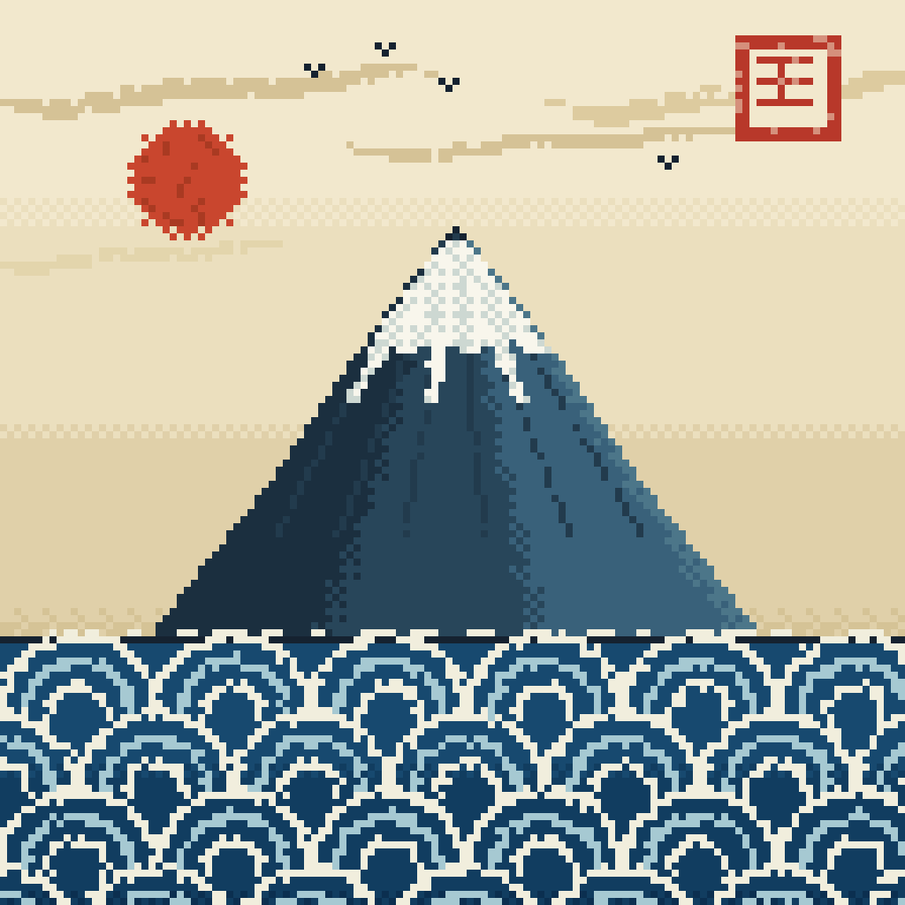

# 示例：浮世绘《富士与青海波》

一份完整的 pixbead 生成器模式范例：**128×128 逻辑画布 × scale 8 → 1024×1024**，24 色，37 个 batch op。
主题为日式浮世绘构图（富士山 + 青海波纹样海面 + 旭日 + 朱文印）。



---

## 1. 成品规格

| 项目 | 值 |
|---|---|
| 逻辑画布 | 128 × 128 |
| 放大倍数 | `--scale 8` |
| 输出 | 1024 × 1024 PNG |
| 唯一颜色数 | 24 |
| batch op 数 | 37 |
| 已绘制像素 | 16384（满幅，无透明） |

```bash
python scripts/pixbead.py init art.pix --width 128 --height 128
python scripts/pixbead.py batch art.pix --ops ops.json
python scripts/pixbead.py render art.pix --out art_1024.png --scale 8
```

生成器：`gen.py`（纯标准库，仅依赖 `math` / `json`；Pillow 只在 render 阶段需要）。

```bash
python gen.py ops.json          # 生成 batch ops
python gen.py ops.json --ascii  # 额外输出字符预览，用于快速校验构图
```

---

## 2. 分辨率选择：逻辑画布要小，放大倍数要大

像素画的"像素感"来自**单个逻辑像素在成图中的物理尺寸**，而不是分辨率高低。

| 逻辑画布 | 放大 | 单元尺寸 | 观感 |
|---|---|---|---|
| 256 × 256 | ×4 | 4 px | 像"低分辨率照片"或"矢量图栅格化"，像素感弱 |
| 128 × 128 | ×8 | 8 px | 明确的像素画方块感 |

同样的 1024×1024 输出，用 128 画布 + ×8 比 256 画布 + ×4 像素感强得多。
代价是细节容量减半，因此构图元素要精简（本例全部元素都能用几何基本形表达）。

---

## 3. 核心技术：色带化渐变 + Bayer 有序抖动

### 3.1 为什么不要平滑线性渐变

把连续渐变逐像素插值能得到成千上万种颜色，结果**看起来像 SVG 渐变被栅格化**——没有颗粒、没有笔触，是"矢量感"的主要来源。

复古像素画的做法是**限色 + 抖动**：只用少数几个色阶，色阶之间用规律的点阵过渡。

### 3.2 色带化（posterize）+ 窄抖动带

```python
BAYER4 = ((0, 8, 2, 10), (12, 4, 14, 6), (3, 11, 1, 9), (15, 7, 13, 5))

def bthr(x, y):
    return (BAYER4[y & 3][x & 3] + 0.5) / 16.0

def dith(c1, c2, t, x, y):
    return c2 if t > bthr(x, y) else c1

def ramp_dith(stops, t, x, y, soft=0.18):
    """色带化渐变：每个色阶内平涂纯色，只在交界处留 soft 比例的抖动过渡带"""
    if t <= stops[0][0]:
        return stops[0][1]
    if t >= stops[-1][0]:
        return stops[-1][1]
    for i in range(len(stops) - 1):
        p0, c0 = stops[i]
        p1, c1 = stops[i + 1]
        if p0 <= t <= p1:
            f = (t - p0) / max(1e-6, (p1 - p0))
            if f > 1.0 - soft:                       # 只在区段末尾 18% 抖动
                return dith(c0, c1, (f - (1.0 - soft)) / soft, x, y)
            return c0                                # 其余 82% 平涂
    return stops[-1][1]
```

关键参数是 `soft`：

- `soft=1.0` → 全程抖动，大面积网点，远看像纱窗／噪点（**反面效果**）
- `soft≈0.15` → 平涂为主的色带，交界处一条窄网点过渡带（**推荐**）

### 3.3 色阶表定义

```python
SKY_STOPS = [(0.0, "#f2e8cd"), (0.36, "#ebdfbe"), (0.70, "#e0d0a9"), (1.0, "#d5c396")]
MT_STOPS  = [(0.0, "#1b2f3f"), (0.35, "#28465a"), (0.70, "#39617a"), (1.0, "#4c7689")]
SEA_STOPS = [(0.0, "#17496f"), (0.55, "#113d60"), (1.0, "#0b2f50")]
```

- 天空 3 段（4 色）→ 会得到 3 条平涂色带 + 3 条抖动过渡带
- 山体 3 段（4 色），横向抖动 → 立体感来自抖动密度而不是彩色渐变
- 海面 2 段（3 色）

### 3.4 抖动只对"大块平涂"有效

**不要**在细节元素上用抖动：弧线、线条、印章笔画、飞鸟必须是纯色单像素，否则会被网点糊掉。

---

## 4. 手绘扰动

纯几何形状（完美圆弧、笔直斜边）即使加了抖动也仍有矢量味。三处扰动即可打破：

```python
def hnoise(x, y, seed=0):
    n = (int(x) * 374761393 + int(y) * 668265263 + seed * 2654435761) & 0xFFFFFFFF
    n = ((n ^ (n >> 13)) * 1274126177) & 0xFFFFFFFF
    return ((n ^ (n >> 16)) & 0xFFFF) / 65535.0
```

| 位置 | 扰动方式 |
|---|---|
| 山体轮廓 | `w = HALF * t**0.95 + 1.1 * sin(t * 8.0) * t`（顶部平滑、山脚起伏） |
| 青海波弧线 | 半径逐点抖动 `rr = r + (hnoise(...) - 0.5) * 1.2` |
| 山脊沟槽 | `hnoise` 控制断点，跳过约 16% 的像素，向下 72% 处截断 |
| 印章 | 边缘 14% 像素向纸色混合，模拟印泥不匀 |

---

## 5. 构图坐标表（128 画布）

| 元素 | 参数 |
|---|---|
| 海平线 | `y = 90` |
| 富士山 | 中心 `x=64`，顶 `y=32`，底 `y=93`，底半宽 `44`；宽度曲线 `t^0.95` |
| 雪线 | 山高 27%，沿部分沟槽下垂（+15%），其余 +6% |
| 旭日 | 圆心 `(26, 25)`，半径 `8`，内部 16% 像素换暗红 |
| 青海波 | 半径 `R=11`，三圈 `11 / 7.5 / 4`，行距 `R`，列距 `2R`，奇数行偏移 `R`，首行圆心 `y = 海平线 + R` |
| 印章 | `x 104–118, y 5–19`，笔画为「三横一竖」 |
| 飞鸟 | 3 像素 V 形（`x-1,y` / `x,y+1` / `x+1,y`） |
| 云带 | 四条，两端按 `min(1, min(t,1-t)*6)` 渐细 |

---

## 6. 迭代记录：走过的三条死路

记录在这里是为了避免重复踩坑。

### ❌ 死路一：用"每列一个顶边高度"画浪 → 必然画成山

用 `y_top[x]` 高度场填充浪体，无论怎么调控制点，屏幕上的结果都是一座山。
原因：高度场是单值函数，本质是地形。真正的卷浪需要轮廓自相交（浪唇悬空、下方有洞），单值函数表达不了。

要画卷浪，必须用**显式闭合多边形轮廓**或**多个形状叠加**，而不是高度场。

### ❌ 死路二：等宽管道 + 双侧分层 → 一根发光的管子

用曲线 + 到曲线距离分层来画浪体，得到的是"圆管状色带"，中间亮两边暗，完全没有浪的形态。

### ❌ 死路三：把泡沫爪当作独立白色粗条

沿浪脊等间距画宽 5~8 px、长 12~26 px 的圆头条，结果是一排白色香肠挂在轮廓上。
修正方向：泡沫应是**沿轮廓连续、厚度随噪声起伏的带**，独立爪只做短而细的小簇点缀。

### ❌ 死路四：256 画布 × scale 4

像素块 4 px，配合平滑渐变 → 被评价为"SVG 感""像矢量图栅格化"。
改用 128 × 8 后问题消失。

---

## 7. 检查清单

出图后逐项确认：

- [ ] 唯一颜色数 ≤ 40（超了说明渐变没量化）
- [ ] 大面积区域是平涂，网点只出现在色阶交界
- [ ] 细节元素（线条、飞鸟、印章）是纯色单像素
- [ ] 轮廓有扰动，不是完美几何
- [ ] `--ascii` 预览中构图重心合理（分布不偏、主体不贴边）
- [ ] 最终图交给用户判断，不靠自检查代替决策
