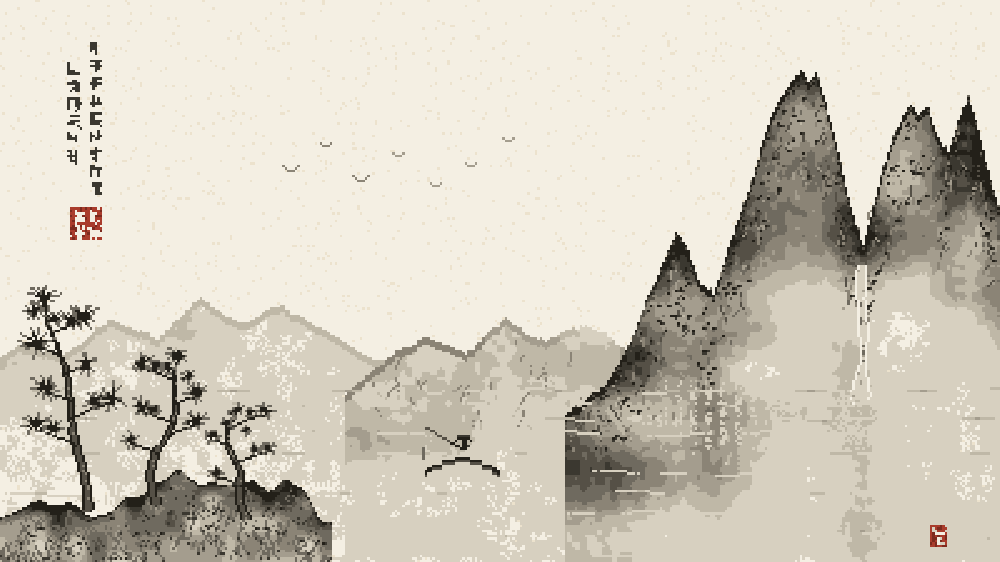

# 示例：水墨山水

一份宽幅（16:9）像素画范例：**400 × 225 逻辑画布 × scale 4 → 1600 × 900**，12 色，46 个 batch op。
主题为中国水墨山水（远山、主峰、云断山腰、瀑布、松石近岸、江心扁舟、飞鸟、题款朱印）。



---

## 1. 成品规格

| 项目 | 值 |
|---|---|
| 逻辑画布 | 400 × 225（精确 16:9） |
| 放大倍数 | `--scale 4` |
| 输出 | 1600 × 900 PNG |
| 唯一颜色数 | 12（纸色 + 8 阶墨 + 2 阶朱印 + 纸纤维点） |
| batch op 数 | 46 |
| 已绘制像素 | 45,283（其余为 `init --background` 的纸色底） |

```bash
python scripts/pixbead.py init art.pix --width 400 --height 225 --background "#f4efe3"
python scripts/pixbead.py batch art.pix --ops ops.json
python scripts/pixbead.py render art.pix --out shanshui_1600x900.png --scale 4
```

生成器：`gen.py`（纯标准库，仅依赖 `math` / `json`；Pillow 只在 render 阶段需要）。

```bash
python gen.py ops.json
```

---

## 2. 宽幅画布的分辨率取舍

16:9 且要求精确输出 1600×900 时，只有少数整数组合：

| 逻辑画布 | scale | 单元尺寸 | 适用性 |
|---|---|---|---|
| 400 × 225 | ×4 | 4 px | **本范例**，比例精确，细节容量够画松针/飞鸟/题字 |
| 320 × 180 | ×5 | 5 px | 像素感更强，但题字与飞鸟会糊 |
| 800 × 450 | ×2 | 2 px | 像素感几乎消失，只剩"低分辨率照片"观感 |

4 px 单元的取舍：**能表现 1 px 的细线（飞鸟、题款笔画），但半调网点会明显放大**——这正是本范例第 3 节要解决的问题。

---

## 3. 核心技法：墨浓度场

### 3.1 水墨不能"填色块"

写意山水的视觉结构是"墨分五色"：同一支笔，笔尖浓、笔肚淡，落纸自然化开。
如果用多边形填充 + 单一颜色，得到的是**灰色剪影**；如果用逐像素平滑渐变，得到的是**渐变栅格化**。两者都不像水墨。

正确模型是把画面看成一个**着墨浓度场** `t ∈ [0,1]`，再统一映射到限定的墨色阶：

```python
def ink_px(t, x, y):
    if t <= 0.012:
        return None                     # 完全留白
    if t < 0.22:                        # 低浓度: 概率点阵 = 墨化开的颗粒
        cov = (t / 0.22) ** 0.85
        return INK[0] if thr(x, y) < cov else None
    u = (t - 0.22) / 0.78               # 中高浓度: 平涂色阶
    p = u * 7.0
    i = int(p)
    if i >= 7:
        return INK[7]
    f = p - i
    soft = 0.26                         # 相邻阶之间只有窄抖动带
    if f > 1.0 - soft:
        return INK[i + 1] if ((f - (1.0 - soft)) / soft) > thr(x, y) else INK[i]
    return INK[i]
```

三个关键设计：

1. **两段式**：低浓度用"概率点阵"（覆盖率 = 浓度），中高浓度用平涂色阶。前者产生墨渗纸的颗粒，后者消除网点。
2. **平涂占大头**：本范例约 70% 的落墨像素落在平涂区，全网点的画法会变成"纱窗"。
3. **窄抖动带** `soft=0.26`：色阶交界处才出现网点，且只占该段的 26%。`soft=1.0`（全程抖动）是反面效果。

墨阶定义（纸 -> 焦墨，亮度等距，8 阶足以表现层次而不产生色带跳变）：

```python
INK = ["#d7d0c0", "#bfb8a7", "#a49d8e", "#8b8476",
       "#6f6a5f", "#555046", "#3b3830", "#232019"]
```

### 3.2 抖动阈值：不要用 Bayer

Bayer 4×4 的网点周期是 4 个逻辑像素。`scale 4` 之后，它就变成 **16 屏幕像素的规则网格**，肉眼立刻读成"半调印刷"或"纱窗"。水墨类题材（大面积淡墨、雾、云）在此处必翻车。

改用**团状随机阈值**——低频值噪声负责成团，高频哈希噪声负责颗粒：

```python
def thr(x, y, seed=0):
    return 0.60 * vnoise(x * 0.21, y * 0.21, seed + 101) + 0.40 * hnoise(x, y, seed + 103)
```

得到的分界不再是网格，而是有机的墨迹边缘。代价是失去了 Bayer 的均匀性，但水墨本来就不要求均匀。

---

## 4. 山体构造

### 4.1 山脊用显式控制点

幂律函数 `y = top + (base-top) * |u|**sharp` 无论怎么调参数，结果都是一个**光滑圆锥**。五座峰并排就是五颗牙。

改用控制点线性插值，让轮廓自带峰顶、崖台、凹槽：

```python
def make_ridge(pts, seed, amp=1.5):
    def f(x):
        for i in range(len(pts) - 1):
            x0, y0 = pts[i]; x1, y1 = pts[i + 1]
            if x0 <= x <= x1:
                u = (x - x0) / max(1e-6, (x1 - x0))
                y = y0 + (y1 - y0) * u
                y += (vnoise(x * 0.19, seed * 9.0, seed) - 0.5) * amp * 2   # 大起伏
                y += (hnoise(x, seed, seed + 55) - 0.5) * 1.1               # 碎石级细扰
                return y
    return f
```

控制点要刻意写出不规则的间距与坡度：陡崖用相邻 2~3 px 的高度骤降，缓坡用 8~10 px 的平缓过渡，峰顶给两个相距 3~5 px 的点做"双尖"而不是单点。

### 4.2 三层叠压 = 纵深

同一套 `mass()` 用三组参数画三次，后画的覆盖先画的：

| 层 | t_top | decay | 作用 |
|---|---|---|---|
| 远山 FAR | 0.32 | 2.2 | 极淡丘陵，无轮廓感，只提供空气透视 |
| 中山 MID | 0.44 | 1.55 | 填住画面中部的空档，浓度不能抢主峰 |
| 主峰 MAIN | 0.92 | 1.15 | 浓墨主体，有勾线、皴、苔点 |

```python
t = t_top * math.exp(-decay * d)                       # 离山脊的垂直深度衰减
t *= 0.40 + 1.00 * vnoise(x * lf, y * lf * 1.5, seed)  # 低频大块墨晕
t *= 0.86 + 0.28 * vnoise(x * 0.33, y * 0.33, seed+3)  # 宣纸吃墨不匀
if y - yt < 2: t = max(t, t_top * 1.30)                # 山脊勾线加重
t *= cloud_f(x, y)                                     # 云遮挡
```

`decay` 决定山的"墨重量"：过大（1.8+）山体下半部直接消失，整体发灰发平；过小（<1.0）则山脚没有留白。

### 4.3 云用离散云团，不用横贯云带

"云断山腰"如果用一条水平云带实现，会在山体上留下一条整齐的横向亮带，非常假。改用若干带软边的离散云团：

```python
CLOUDS = [(246, 130, 56, 20, 0.28), (304, 148, 44, 17, 0.24), (364, 132, 40, 16, 0.32)]
#  (cx, cy, rx, ry, floor)  floor = 云心处残墨比例

def cloud_f(x, y):
    f = 1.0
    for (cx, cy, rx, ry, fl) in CLOUDS:
        d = math.hypot((x - cx) / rx, (y - cy) / ry)
        d += (vnoise(x * 0.05, y * 0.06, 37) - 0.5) * 0.55   # 云边不规则
        if d < 1.0:
            f = min(f, fl + (1.0 - fl) * (abs(d) ** 0.55))
    return f
```

`floor > 0` 很重要：云心保留 20%~30% 的残墨，山才不会真的"断"成两截。

---

## 5. 元素画法速查

| 元素 | 画法 | 关键参数 |
|---|---|---|
| **皴法** | 从山脊向下延伸的断续斜笔，长度 4~13 px，末端降两阶墨色 | 主峰 120 条 + 60 条短皴；**超过 150 条就会把山画成毛皮** |
| **苔点** | 山体上的两点浓墨 + 偶尔一点拖尾，暗示远树丛 | 230 枚，半随机散布 |
| **松针** | 以一点为中心向外的**放射状针球**（9~13 根针，长 4~7 px，留空隙） | 半径 4~7 px；中心点浓墨 |
| **松干** | 下粗（4 px）上细（1 px）的扭曲纵向块，中间填中墨、边缘焦墨 | 每 20% 高度断开一次做"树皮断笔" |
| **舟** | 30 px 长弧形船身（中部低、两端上翘），加 2 px 厚的船舷 | 首尾额外 1 px 翘头 |
| **渔翁** | 扁弧斗笠（7 px）+ 2×4 竖块身体 + 斜向鱼竿 + 竿梢垂线 | 高度控制在 10 px 内 |
| **飞鸟** | V 形，翼展 2~3 px，左右各 `i` 个像素、上抬 `i*0.85` | 纯色单像素，不抖动 |
| **题款** | 5×5 网格内随机布 3~5 段横/竖/撇笔画，字距 2 px、行距 7 px | 竖排两列，远看读作书法 |
| **朱文印** | 13×13 朱红方，印面 12% 像素随机镂空，内部四格各画一字（用纸色） | 边框外留 1 px 边距 |

---

## 6. 构图坐标表（400 × 225）

| 元素 | 坐标 / 参数 |
|---|---|
| 纸色 | `#f4efe3`，`init --background` 铺底 |
| 纸纤维 | 阈值 `hnoise > 0.972`（约 2.8%），色 `#ece2cd` |
| 远山 | 控制点 12 个，`x -10~250`，峰高 `y 120~144`，amp 0.9 |
| 中山 | 控制点 10 个，`x 138~282`，峰高 `y 128~145`，amp 1.4 |
| 主峰 | 控制点 38 个，`x 226~400`，最高点 `(320, 31)` / `(326, 30)`（双尖），amp 2.4 |
| 云团 | `(246,130,56,20,.28)` `(304,148,44,17,.24)` `(364,132,40,16,.32)` |
| 瀑布 | `x = 345`，`y 106~162`，半宽 `1.2 + 1.0t`，中心纯纸色、两侧极淡墨 |
| 瀑底水雾 | 以 `(345, 166)` 为心的椭圆渐变，半径 `20 × 17` |
| 主峰倒影 | `x 266~400`，`y 152~188`，每 3 列取 1 列 |
| 水纹 | 10 条基线 `y 156~222`，行距 5~9，段长 18~34，断续 + 正弦起伏 |
| 坡石 | `x 0~132`，基线 `y ≈ 198 ± 11`，`x > 132` 返回 None 截断 |
| 松树 | 三棵：`(32,204,h84)` `(63,201,h58)` `(96,207,h42)`，针球半径 6.5 / 5.0 / 3.8 |
| 小舟 | `(170, 184)`，长 30 px；渔翁在 `x = 185` |
| 飞鸟 | 7 只：`(116,68)` `(130,58)` `(144,72)` `(159,62)` `(174,74)` `(188,66)` `(203,56)` |
| 题款 | 右列 `x 36`，`y 17` 起 9 字；左列 `x 27`，`y 25` 起 6 字；字距 7 |
| 名章 | `(28, 83)`，13 × 13 |
| 闲章 | `(372, 210)`，7 × 9 |

---

## 7. 迭代记录：五版才成

这个题材画了五版。记录失败路径比记录成功路径有用。

### ❌ 死路一：幂律山形 → 一排锯齿

五座峰用 `top + (base-top)*|u|**sharp` 叠出来，无论 `sharp` 取什么都得到连续的尖锥，读作"锯齿"或"牙齿"。见 4.1，必须换显式控制点。

### ❌ 死路二：Bayer 抖动铺满淡墨 → 屏幕门

6 阶墨 + 全程 Bayer 抖动，在 `scale 4` 下变成规则网格，整幅画读作"半调印刷"。远山、云、水全被网格吃掉。
修正：换团状随机阈值（3.2），并把 70% 以上像素推进平涂区（3.1）。

### ❌ 死路三：皴线全铺 → 毛皮

主峰画了 700 条 5~19 px 的垂直皴线，山体变成垂下的毛皮或挂面，比不画皴还糟。
修正：降到 120 条，长度压到 4~13 px，颜色不再用焦墨（降到第 5 阶），并加大斜向漂移。

### ❌ 死路四：中山等距起伏 → 剪刀

中山控制点每 8 px 一个峰，形成密集尖角锯齿，视觉上比主峰还抢眼。
修正：控制点间距拉开到 18~22 px（10 个点覆盖 144 px），浓度从 0.58 降到 0.44。

### ❌ 死路五：瀑布画成"劈山白柱"

瀑布用纯纸色竖条 + 两侧硬墨边，在淡墨山体上变成一根立着的白柱。
修正：主体收窄到半宽 1.2~2.2 px，中心纯纸色、两侧改用极淡墨过渡，去掉硬边；下端加椭圆水雾散开。

### ⚠ 未解决项（继续画时优先处理）

- 中山仍有几座收得过尖，需要更多"缓顶"控制点
- 山体的大块墨晕边界有轻微块状感（低频值噪声的等值面），需要叠两个八度的值噪声
- 松树偏瘦，树冠需要增加 30% 的针球密度

---

## 8. 检查清单

- [ ] 唯一颜色数 ≤ 40（本范例 12）
- [ ] 70% 以上落墨像素在平涂区，网点只出现在色阶交界
- [ ] 放大 4 倍后看不到规则网格（把图缩小到 50% 再放大看，网格会跳出来）
- [ ] 细节元素（飞鸟、题款、印章笔画）是纯色单像素，不参与抖动
- [ ] 山脊轮廓有峰/崖/凹槽，不是单一圆锥
- [ ] 皴线数量与山体面积匹配（500×300 以内不超过 150 条）
- [ ] 云团之间有断开，不是一条横带
- [ ] 最终图交给用户判断，不靠自检代替决策
