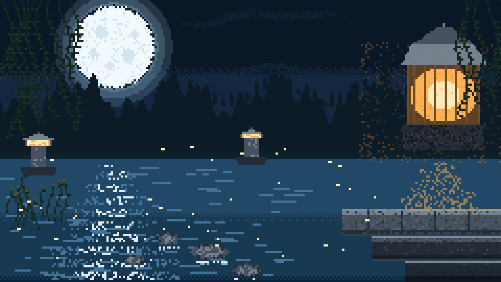

# 示例：月夜庭院（16:9 宽幅夜景）

第二份 pixbead 生成器范例，与 [`fuji-seigaiha`](../fuji-seigaiha/) 互补：**横构图 + 双色温光源 + 水面反射**。
此例还有一个重要价值：它记录了"**人物是高成本元素**"这条结论，以及最终**删除人物**的决策过程。



---

## 1. 成品规格

| 项目 | 值 |
|---|---|
| 逻辑画布 | 240 × 135（16:9） |
| 放大倍数 | `--scale 6` |
| 输出 | 1440 × 810 PNG |
| 唯一颜色数 | 85 |
| batch op 数 | 113 |

```bash
python scripts/pixbead.py init art.pix --width 240 --height 135
python scripts/pixbead.py batch art.pix --ops ops.json
python scripts/pixbead.py render art.pix --out art_1440.png --scale 6
```

生成器：`gen.py`

```bash
python gen.py ops.json
python gen.py ops.json --ascii     # 字符预览，快速校验构图
```

---

## 2. 分辨率与人物像素预算

这张图从 160×90 起步，为了画好人物提到 240×135。**人脸可用像素数决定了能不能画人**：

| 画布宽度 | 头高 | 眼睛可占 | 结果 |
|---|---|---|---|
| 160 | 约 14 px | 2–3 px | 五官糊成一团，无法做角色 |
| 240 | 约 33 px | 7×8 px | 可以画杏仁眼白 + 三层虹膜 + 瞳孔 + 双高光 |

参考预算（240 宽画布下的 4 头身侧坐角色）：

| 部位 | 像素尺寸 |
|---|---|
| 头（含下巴） | 26 × 33 |
| 眼睛 | 6×7 / 7×8（远侧小、近侧大） |
| 眼间距 | 1 眼宽 |
| 鼻子 | 1–2 px |
| 嘴 | 7 px 宽 |
| 脖子 | 10 px 宽 |
| 躯干（裙） | 34 × 38 |
| 单条腿 | 7–8 px 粗 |

**结论：低于 200 px 宽的画布不要画人物**，改画景物。

---

## 3. 人物画法的关键点（若一定要画）

### 3.1 图层顺序

```
头发底层 → 腿 → 手臂 → 裙 → 颈 → 脸型 → 刘海 → 猫耳 → 眼睛 → 鼻嘴 → 腮红 → 边缘光
```

头发必须**先画、贴背侧**，且**宽度不超过头宽的 1.2 倍**。超过就会把整个身体吞成一块白色（实测 1.5 倍时人物完全不可读）。

### 3.2 脸型要用多边形而非椭圆

正圆的脸会读成"方块脸"。用 14 点左右的多边形，上宽下窄，收出尖下巴：

```python
FACE_PTS = [(146, 40), (147, 33), (152, 29), (158, 27), (165, 28),
            (170, 32), (172, 40), (170, 47), (166, 53), (161, 58),
            (158, 60), (155, 58), (150, 53), (146, 47)]
```

### 3.3 刘海要实心覆盖额头

用"环形/月牙形"多边形画刘海会留下空白额头，读成秃头。正确做法是**先把额头区域所有肤色像素替换成发色**，再在发际线处加几缕尖角。

### 3.4 动漫眼的构造

```python
# 1. 杏仁形眼白（sin 控制逐行宽度，中段最宽）
# 2. 虹膜：椭圆，占眼白 72%，上缘深、中段亮
# 3. 瞳孔：虹膜中央的深色椭圆
# 4. 下缘反光：虹膜最下方一行换成亮色
# 5. 高光：左上 2×2 白点 + 右下角一个小反光
# 6. 上睫毛：整条粗黑线 + 外眼角上挑 2px
# 7. 下眼线：浅色虚线
```

高光位置固定在**虹膜左上**，这是动漫眼的通用语言。

### 3.5 双光源边缘光

夜景里人物同时被冷月（左）和暖灯（右）照亮，两侧边缘光颜色必须分开：

```python
# 左缘：混入月光的冷色
put(x, y, mix(DRESS_H, MOON_GLOW, 0.5))
# 右缘：混入灯笼的暖色
put(x, y, mix(DRESS_H, LAMP_GLOW, 0.5))
```

这一步能让黑色衣服在深色背景里"立"起来，否则会糊成一团。

---

## 4. 决策记录：最终删掉了人物

人物迭代了 6 版（160×90 三版 + 240×135 三版），效果依次改善但仍达不到可交付水准，最终**整块移除**，改为纯景物。

移除后画面质量立刻达标。经验：

- 人物是**高成本元素**：占用大量像素预算，且任何一处比例/五官失准都会被立刻察觉
- 景物元素（月亮、灯笼、水面、树）**容错率高**，简化后反而更有氛围
- 若人物画不到让自己满意的程度，**果断删掉**比反复修补更划算
- 删掉人物后要补景：原人物占位改造成空石阶，并补水岸细节（踏脚石、芦苇、苔痕）填补视觉空缺

---

## 5. 双色温光源的处理

| 光源 | 位置 | 颜色 | 影响范围 |
|---|---|---|---|
| 月亮 | 左上 (54, 22) r=19 | `#86aec6` 冷蓝 | 月面、月晕、水面倒影、石台左端、冷色边缘光 |
| 石灯笼 ×2 | (18,60) (120,58) | `#ffb254` 暖橙 | 灯芯、小范围光晕 |
| 大灯笼 | (212, 16) | `#ffe9b8` 核心 + `#ffb254` 中层 | 灯笼本体、大面积光晕、石台右端、暖色边缘光 |

要点：

- **光晕用低密度噪声点扩散**（`hnoise < 0.16`），不要用连续渐变，否则会糊成一片脏色
- 冷暖交界区域（画面中部）保持中性，不要两侧光晕重叠
- 水面反射：月光用**断续横条**（越远越窄），灯光用**纵向抖动柱**

---

## 6. 构图坐标表（240 × 135）

| 元素 | 参数 |
|---|---|
| 天空 | 4 段色带抖动，`#0a1726 → #224867` |
| 月亮 | 圆心 `(54,22)`，半径 `19`，外晕至 r+11 |
| 远树林 | 基线 `y≈46 + 7sin(0.13x) + 4sin(0.36x) + 3sin(0.81x)`，填充至 y=86 |
| 海平线 | `y = 76` |
| 水面 | `y 76–135` 全幅，2 段色带抖动 |
| 月光倒影 | 自 `y=79` 起，宽度 `7 + 0.35d`，断续横条 |
| 石阶 | 三层：`(164,100)–(240,112)` / `(178,113)–(240,124)` / `(194,125)–(240,134)` |
| 踏脚石 | `(100,120,9,4)` `(118,129,7,3)` `(80,114,6,3)` `(64,124,5,2.5)` |
| 芦苇 | 左下 11 根，`sin` 扰动枝干 + 顶端穗 |
| 石灯笼 | `(18,60)` 高 20 / `(120,58)` 高 17 |
| 大灯笼 | 中心 `x=212`，顶 `y=16`，身宽 ±17，高 44 |
| 萤火 | 40 点，`y 70–128` 随机分布 |

---

## 7. 检查清单

- [ ] 唯一颜色数 ≤ 100（本例 85）
- [ ] 冷暖光源的边缘光颜色不同
- [ ] 光晕用稀疏噪声点，不是连续渐变
- [ ] 水面反射指向正确（在光源正下方）
- [ ] 画布宽度 < 200 px 时不画人物
- [ ] 人物的头发宽度 ≤ 头宽 × 1.2
- [ ] 刘海实心覆盖额头
- [ ] 出图后交给用户判断，不靠自检代替决策
