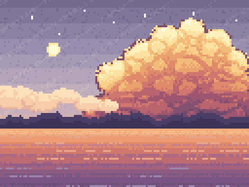

# 示例：黄昏天空横幅

**128 × 96 逻辑画布 × scale 4 → 512 × 384**，57 色，57 个 batch op。
主题为黄昏天空：紫灰夜空 + 暖色积云 + 远岛剪影 + 一截反光海面。



---

## 1. 成品规格

| 项目 | 值 |
|---|---|
| 逻辑画布 | 128 × 96（4:3） |
| 放大倍数 | `--scale 4` |
| 输出 | 512 × 384 PNG |
| 唯一颜色数 | 57 |
| batch op 数 | 57 |
| 已绘制像素 | 12,288（满幅） |

```bash
python gen.py ops.json
python scripts/pixbead.py init art.pix --width 128 --height 96 --background "#736a90"
python scripts/pixbead.py batch art.pix --ops ops.json
python scripts/pixbead.py render art.pix --out sky_512x384.png --scale 4
```

---

## 2. 核心技术：多瓣云 + 全局高度场

### 2.1 不用每个瓣各自渐变

积云由十几个圆润的"瓣"堆成。直觉做法是每瓣画一个独立的球状渐变，结果是**一串葡萄**——每个球都有自己的亮暗中心，整体失去"一朵云"的形体。

正确做法分两步，把"轮廓"和"明暗"拆开：

```python
# ① 轮廓: 瓣的并集, 边界用值噪声打散
def bulge_nd(x, y, cx, cy, rx, ry, seed):
    nd = ((x - cx) / rx) ** 2 + ((y - cy) / ry) ** 2
    nd += (vnoise(x * 0.30, y * 0.30, seed) - 0.5) * 0.40   # 边缘不规则
    return nd

def cloud_top(x, bulges):
    """该列云顶高度 = 所有瓣在该列的上缘最小值"""
    t = None
    for (cx, cy, rx, ry) in bulges:
        if abs(x - cx) < rx:
            u = (x - cx) / float(rx)
            ytop = cy - ry * math.sqrt(max(0.0, 1.0 - u * u))
            if t is None or ytop < t:
                t = ytop
    return t

# ② 明暗: 用"整朵云的相对高度", 与具体哪个瓣无关
v = (y - cloud_top(x)) / span        # 0=云顶 1=云底
v += seam                            # 瓣接缝处补一点阴影, 保留层次
```

这样整朵云从顶部的亮黄到底部的粉紫是**一条连续色带**（`CLOUD` 12 阶），而瓣的起伏只体现在轮廓和接缝阴影上。

### 2.2 云色带（12 阶，黄 → 橙 → 粉紫）

```python
CLOUD = [(0.00, "#fffbe0"), (0.09, "#fdf1bd"), (0.18, "#fbe2a2"),
         (0.27, "#f8d08c"), (0.36, "#f2bb7a"), (0.45, "#eaa36e"),
         (0.54, "#df8b6b"), (0.63, "#cf766e"), (0.72, "#b9636f"),
         (0.82, "#9e5570"), (0.91, "#83506f"), (1.00, "#6c4a6a")]
```

配一个更淡的 `CLOUD_FAR`（4 阶粉橙）画远处小云，形成空气透视。

### 2.3 三个让云"发实"的细节

| 细节 | 做法 | 作用 |
|---|---|---|
| 瓣接缝 | `nd ∈ [0.70, 1.06]` 时 `seam = 0.16` | 保住内部层次，不变成一块平板 |
| 外缘压暗 | `min_nd > 0.80` 时换成 `CLOUD_EDGE` | 轮廓清晰，不与天空糊在一起 |
| 横向偏移 | `v += (x - W*0.26)/W * 0.13` | 右暗左亮，暗示光源在左 |

---

## 3. 天空与海面

### 3.1 天空：9 阶渐变 + 斜向云丝

```python
s = x * 0.55 + y * 0.83          # 斜向坐标(等值线为 -45° 左右)
if int(s) % 12 in (0, 1) and hnoise(x, y, 3) > 0.48:
    c = SKY_STREAK[i]            # 比底色亮一阶
```

三个参数都要收敛，否则会变成"雨丝"：

| 参数 | 过密的表现 | 本范例取值 |
|---|---|---|
| 条带周期 `% N` | N ≤ 7 时像下雨 | `% 12` |
| 断续概率 | 低于 0.3 时连成实线 | `> 0.48` 才画 |
| 色差 | 亮两阶以上会抢视线 | 只亮一阶 |

### 3.2 海面：横向色带 + 波纹

单靠一条垂直渐变，海面会像一块塑料板。加两类横向元素即可：

- **色带**：在固定 y 上整行换色（断续，`hnoise > 0.22`），每 5px 一条
- **波纹**：基线 + 正弦微起伏 + 随机断续，越远越密

---

## 4. 构图坐标表（128 × 96）

| 元素 | 坐标 / 参数 |
|---|---|
| 地平线 | `HORIZON = 62` |
| 海面 | `y = 66 ~ 96` |
| 主积云 | 14 个瓣，`x 64~128`，云顶 `y = 16`，云底压到 `y = 63` |
| 左侧远云 | 6 个瓣，`x 1~61`，`y 47~54`，用 `CLOUD_FAR` |
| 太阳 | 圆心 `(27, 25)`，半径 3，外圈 1px 暖黄光晕 |
| 星星 | 9 颗，`(16,8) (30,17) (43,5) (58,11) (74,7) (99,6) (112,19) (86,15) (121,10)` |
| 远岛 | 起伏幅度 ±2 px，`hnoise > 0.92` 处冒出 1px 树梢 |
| 海面反光 | `y = 67~69` 的金色断续带 |
| 海面色带 | `y = 74 79 84 89 94` 五条 |
| 海面波纹 | `y = 70 73 77 81 86 90 95` 七条，段长 11~18 |

---

## 5. 最重要的教训：卷浪为什么画不出来

这个范例原本是一幅竖幅黄昏海景，画面里有一只**近景大卷浪**。那只浪画了 **10 版全部失败**，最终整块删除。这段记录比上面所有技法都有价值。

### 5.1 失败轨迹

| 版本 | 方法 | 结果 |
|---|---|---|
| v1 | 幂律函数 `top + (base-top)*\|u\|**sharp` | 尖三角帐篷 |
| v2–v3 | 圆顶钟形 / 左陡右缓 | 馒头 / 青绿丝带 |
| v4 | 抬到 26px + 厚白边 | 三角滑梯 |
| v5 | 顶部 7px 泡沫面 + 深青管 | 白三角旗 |
| v6 | 浪身 7 层水色带 | 青水三角 + 绿斑 |
| v7 | 螺旋弧浪唇（参数化月牙） | 白色弧像贴上去的标志 |
| v8 | 白色泡沫团 + 青影噪声 | 青绿苔藓石头 |
| v9 | 调整 shade 比例让白色占主导 | 泡沫堆成的石头 |
| v10 | **手摆字符画模板** | 模板行首对齐错误，画成一块白帆 |

### 5.2 根本原因

卷浪有三个特征，**生成器范式天生表达不了**：

1. **遮挡关系**：浪唇卷回来会挡住自己的浪壁，是"实体叠实体"，不是单一高度场
2. **自由曲率**：浪唇的卷、浪谷的凹、浪尾的翘，三段曲率方向都不同，没有统一的函数形式
3. **泡沫的不规则**：参考作品里的白泡沫是不规则块团，大小疏密全无规律

更关键的一层：用户两次反馈都是"**不像一个图层**"（边缘太硬 + 浪悬在水面上）。这说明问题不在形状，而在**形体与环境的融合**——而融合靠的是大量手绘的过渡像素，不是某个参数能调出来的。

### 5.3 三条可复用的判断规则

1. **迭代 3~4 版仍不达标，就是方法错了，不是参数错了。** 立刻停手换方法，不要继续微调。这次画到第 10 版才承认，浪费了大量往返。
2. **先判断元素属不属于"可以用场描述"的类型**：

   | 可以用场/函数描述 | 必须手摆像素 |
   |---|---|
   | 云、雾、天空渐变（团块 + 高度场） | 卷浪、织物褶皱、手指 |
   | 山体（山脊控制点 + 深度衰减） | 有遮挡的复杂有机体 |
   | 水面（横向色带 + 波纹） | 需要"立体感 + 不规则泡沫"的东西 |

3. **画不好就果断砍掉，画面往往更好。** 这次删掉浪之后，整幅海景的色系统一（紫粉海面 + 暖橙云），重心明确，质量立刻达标。这与 `examples/moonlit-pond` 里"人物迭代 6 版不达标、整块删除后画面立刻达标"是同一个决策。

### 5.4 如果一定要画卷浪

不要用参数化。用**手摆像素模板**，但注意：

- 模板必须**左对齐补齐空格**（`"....##...."` 而不是 `"....##"`），否则行首偏移会让形状整体歪掉——v10 就是死在这里
- 一个 46×30 的模板大约能表达一只小浪，超过这个尺寸需要分块拼接
- 先画轮廓（白色泡沫），再单独叠一层"透过泡沫看到的水"（青色阴影），不要试图一次算出来

---

## 6. 非整除尺寸怎么处理

用户要求输出 506 × 679 时（506÷4 = 126.5，679÷4 = 169.75），有三种做法：

| 做法 | 结果 | 评价 |
|---|---|---|
| 逻辑画布 506×679，`scale 1` | 尺寸精确 | 像素块只有 1px，像素画感完全消失 |
| 逻辑 126×170 `×4` 得 504×680，再 Pillow 补边裁边 | 尺寸精确且网格完整 | 可行，但要额外脚本补 2 列、裁 1 行 |
| **选一个比例相同且能整除的尺寸**（本范例 128 × 172 ×4 = 512×688） | 比例 0.7442 vs 目标 0.7452 | **推荐**，无后处理、无失真 |

补边脚本要点：只在画面**纯色边缘**补（例如海面无纹理区），把最外一列复制出去，肉眼不可见。如果边缘是渐变或细节，补边会露馅。

---

## 7. 检查清单

- [ ] 唯一颜色数 ≤ 60（本范例 57；插画类比图形类允许更多）
- [ ] 云的明暗来自"整朵相对高度"，不是每个瓣各自渐变（否则成葡萄串）
- [ ] 天空斜纹周期 ≥ 10 且只亮一阶（否则成雨丝）
- [ ] 海面有横向色带，不是单一垂直渐变
- [ ] 边缘不发硬：色阶交界只有 soft≈0.16 的窄抖动带
- [ ] 有遮挡/自由曲率的有机形体没用参数化硬做
- [ ] 删掉某个元素后画面是否更好 —— 值得主动试一次
- [ ] 最终图交给用户判断，不靠自检代替决策
